# Assignment 02 — Provision Linux VMs with Terraform and Run Ansible Ad-Hoc Commands

Part of the DevOps Micro Internship (DMI) with Agentic AI

---

## Purpose

In this assignment, you will use Terraform to provision three or four Ubuntu Linux Virtual Machines on either Microsoft Azure or Amazon Web Services.

You will configure SSH key-based authentication, organize the servers using a custom Ansible inventory, and run Ansible ad-hoc commands across individual hosts and inventory groups.

---

# Task 1 — Create the Multi-Host Lab Structure

## Goal

Create a separate project directory for the multi-host lab and prepare the Terraform, Ansible, and documentation files.

This project will use the Git repository and Ansible controller prepared in Assignment 01.

### Evidence

#### Screenshot 1 — Terminal showing the complete `ansible-adhoc-lab` project structure

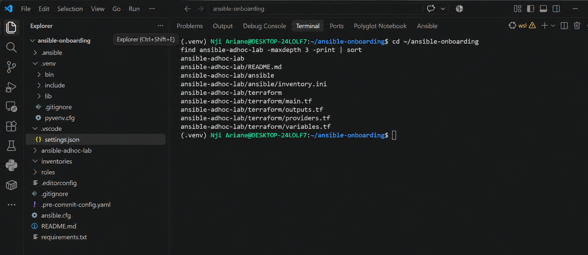

---

#### Screenshot 2 — Terminal showing `git status --short` with the new project files and updated `.gitignore`

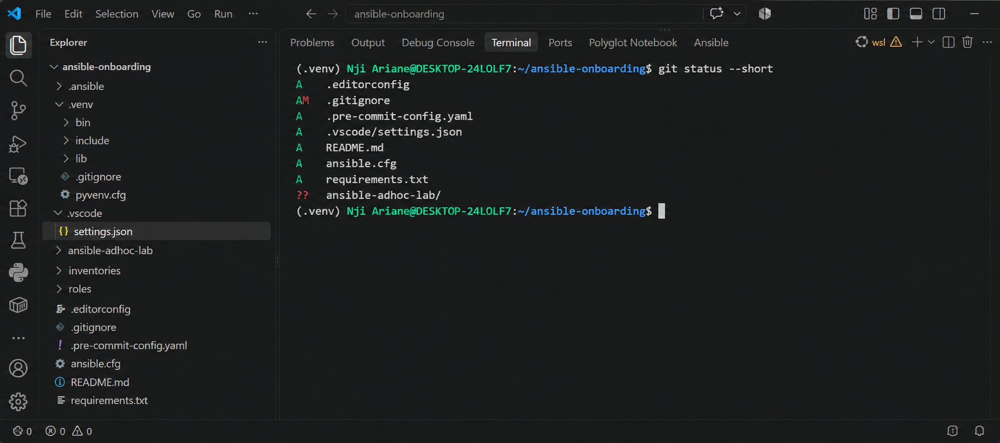

---

### Notes

Add your task notes here.

---

# Task 2 — Create the Terraform Configuration

## Goal

Create the Terraform configuration required to provision three or four Ubuntu Linux VMs on your selected cloud platform.

Complete only one option:

- Option A — Microsoft Azure
- Option B — Amazon Web Services

Do not configure both providers for this assignment.

### Evidence

#### Screenshot 3 — Terraform configuration showing the three or four server roles and the `for_each` or `count` implementation

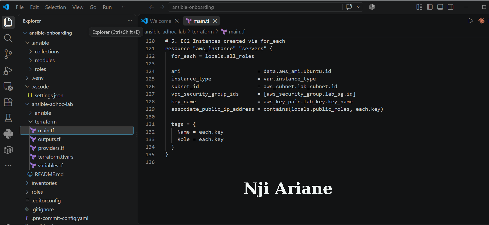

---

#### Screenshot 4 — Terraform configuration showing SSH restricted to the controller IP and HTTP allowed only for web hosts

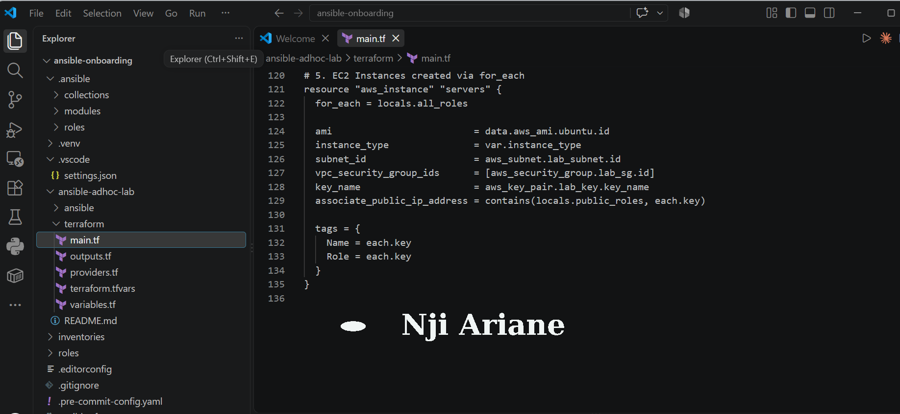

---

#### Screenshot 5 — Terraform output configuration showing how public IP addresses are associated with the server roles

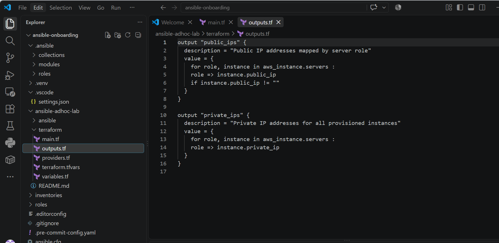

---

### Notes

Add your task notes here.

---

# Task 3 — Provision the Infrastructure with Terraform

## Goal

Initialize and validate the Terraform configuration, review the execution plan, provision the selected three or four VMs, and retrieve their public IP addresses.

### Evidence

#### Screenshot 6 — Final `terraform apply` output showing `Apply complete`

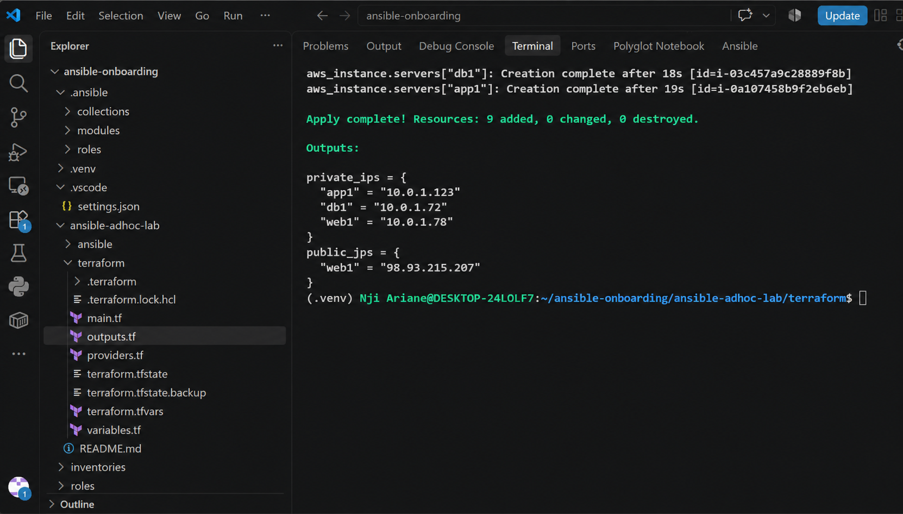

---

#### Screenshot 7 — `terraform output public_ips` showing the role-to-IP mapping for all three or four VMs

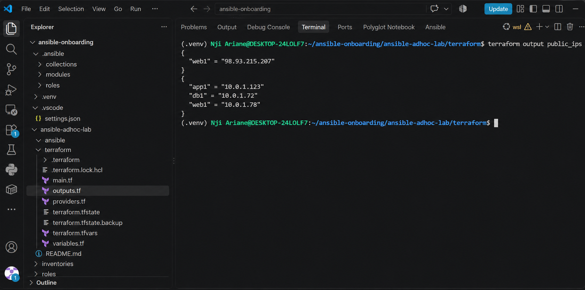

---

#### Screenshot 8 — Azure Portal or AWS Management Console showing all three or four VMs in the `Running` state, with their role-based names visible

Add your screenshot here.

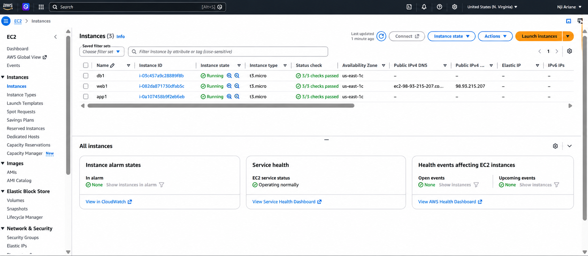

### Notes

Add your task notes here.

---

# Task 4 — Verify SSH Key-Based Access

## Goal

Verify that each managed VM can be accessed from the Ansible controller using SSH key-based authentication.

### Evidence

#### Screenshot 9 — Terminal showing successful SSH hostname output from all VMs

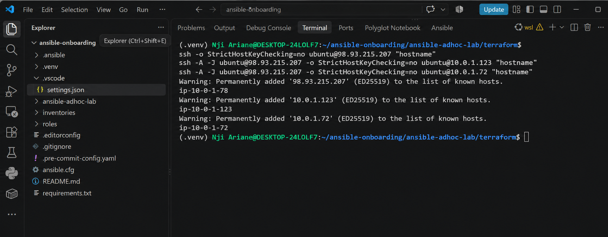

---

### Notes

Add your task notes here.

---

# Task 5 — Create the Custom Ansible Inventory

## Goal

Create an Ansible inventory file that groups the managed VMs by role.

The inventory allows Ansible to run commands against all servers, or only specific groups such as `web`, `app`, or `db`.

### Evidence

#### Screenshot 10 — `inventory.ini` showing the `web`, `app`, and `db` groups

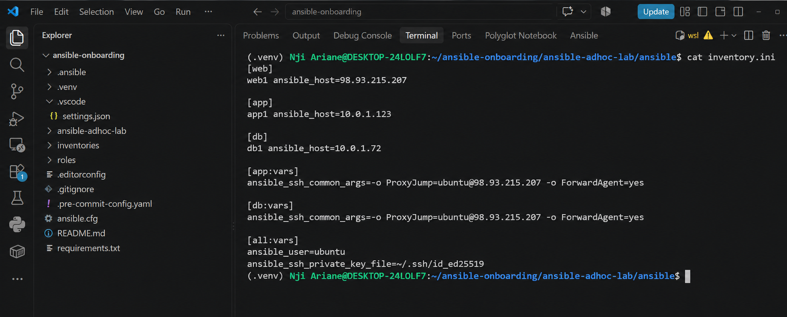

---

#### Screenshot 11 — Output of `ansible-inventory -i inventory.ini --graph`

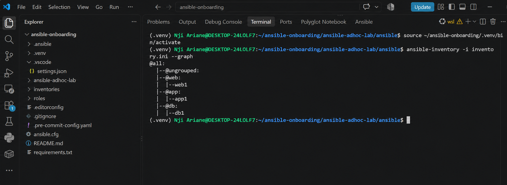

---

### Notes

Add your task notes here.

---

# Task 6 — Run Ansible Ad-Hoc Commands

## Goal

Run Ansible ad-hoc commands from the controller to verify connectivity, check server information, and manage packages and services across inventory groups.

This task proves that the inventory is working and that Ansible can control multiple managed VMs without writing a playbook.

### Evidence

#### Screenshot 12 — Output of `ansible all -i inventory.ini -m ping`

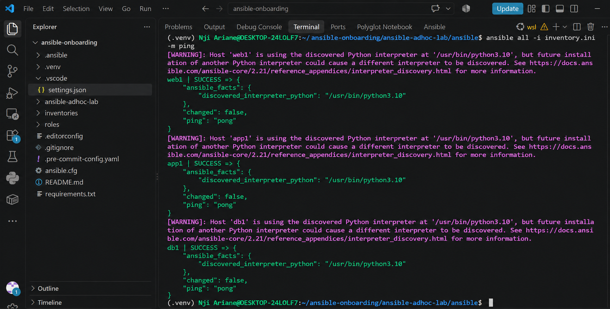

---

#### Screenshot 13 — Output of `ansible all -i inventory.ini -m command -a "uptime"`

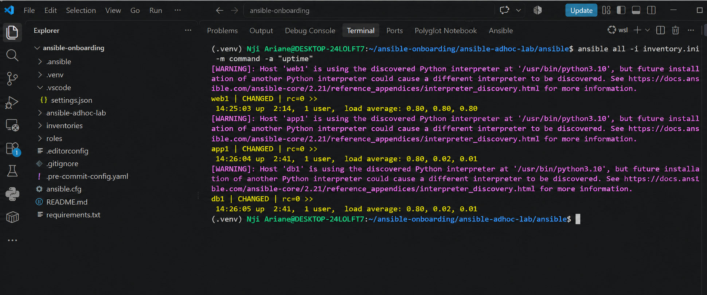

---

#### Screenshot 14 — Output of `ansible web -i inventory.ini -m apt -a "name=nginx state=present update_cache=yes" --become`

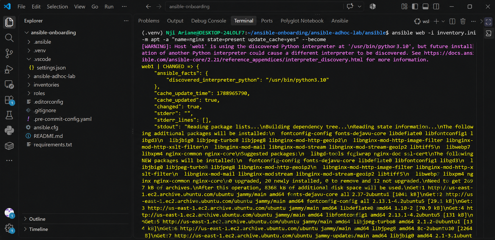

---

#### Screenshot 15 — Output of `ansible web -i inventory.ini -m service -a "name=nginx state=started enabled=yes" --become`

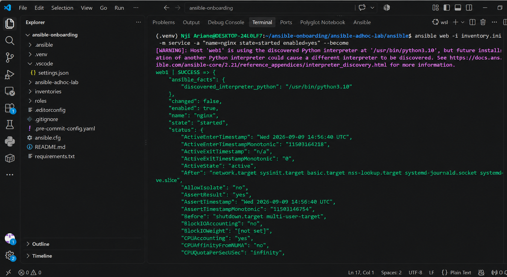

---

#### Screenshot 16 — Output of `ansible all -i inventory.ini -m apt -a "name=htop state=present update_cache=yes" --become`

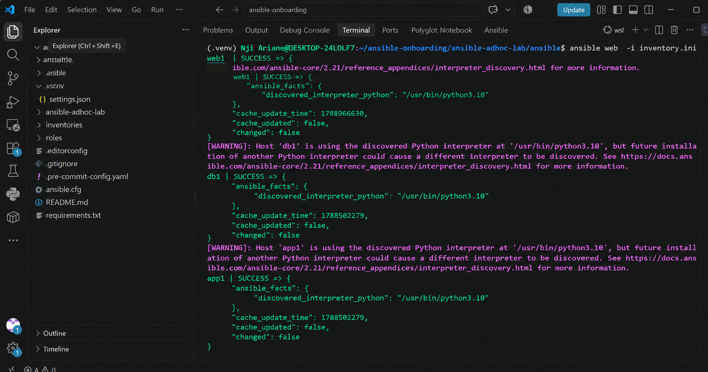

---

#### Screenshot 17 — Output of `ansible web -i inventory.ini -m command -a "systemctl is-active nginx"`

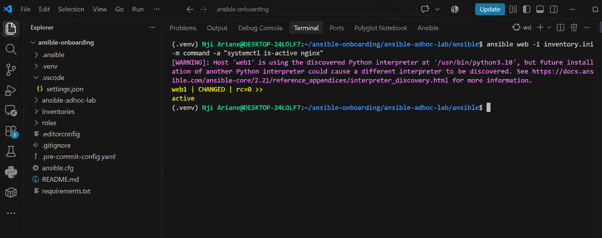

---

### Notes

Add your task notes here.

---

# LinkedIn Post Required

## Evidence

#### LinkedIn Post URL

Paste your LinkedIn post URL here

https://lnkd.in/p/dRQaZUJt

---

#### Screenshot — Published LinkedIn post

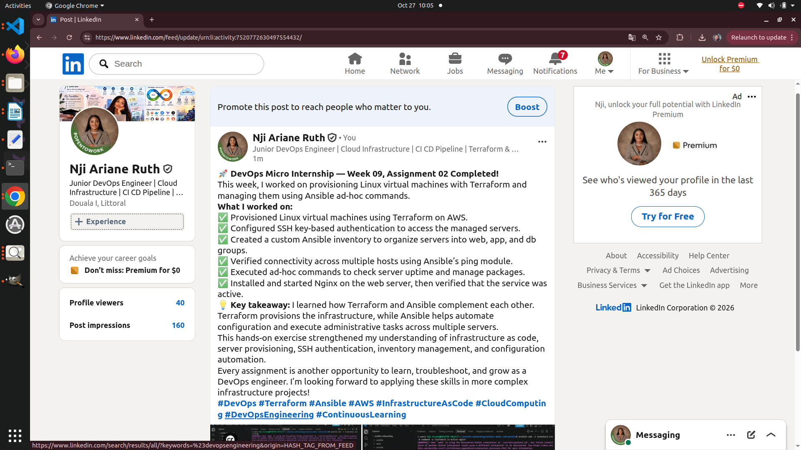
---

# Assignment Questions

Answer the following in your own words:

**1. What is the purpose of an Ansible inventory file?**

An Ansible inventory file contains the IP addresses or hostnames of the servers Ansible manages. It allows me to organize servers into groups and specify how Ansible should connect to them. This makes it easier to run commands on individual servers or multiple servers at once.

---

**2. What is the difference between the `web`, `app`, and `db` groups in your inventory?**

The web group contains servers responsible for handling web traffic and serving web pages, such as servers running Nginx. The app group contains servers that run the application's backend and business logic. The db group contains servers responsible for storing and managing application data in a database. Grouping servers this way makes infrastructure management more organized.
---

**3. What does the Ansible `ping` module verify?**

The Ansible ping module verifies that Ansible can connect to a managed host and execute a basic task using Python on the remote machine. A successful response confirms that the host is reachable through Ansible and that the connection and execution environment are working.
---

**4. Why do package installation commands require `--become`?**

Package installation commands usually require administrator or root privileges to install software and modify system files. The --become option allows Ansible to execute the command with elevated privileges, usually through sudo, so packages can be installed successfully.

---

**5. When would you use an ad-hoc command instead of a playbook?**

I would use an ad-hoc command for quick, one-time tasks such as checking server uptime, testing connectivity, or installing a package on a few servers. I would use a playbook for more complex or repetitive tasks that require multiple steps, structured automation, and consistent execution.

---

**6. What is one challenge you faced while setting up SSH or inventory, and how did you fix it?**

One challenge I faced was configuring SSH connectivity between my local machine and the provisioned virtual machines. I needed to ensure that the correct private key, username, and public IP addresses were used. I fixed this by verifying my SSH configuration and key permissions, testing the SSH connection to each server, and checking that the correct IP addresses were listed in my Ansible inventory. After confirming connectivity, I used Ansible's ping module to verify communication with the managed hosts.
---

# Required Files

Confirm that the following files are included in your assignment workspace:

- [x] `ansible-adhoc-lab/README.md`
- [x] `ansible-adhoc-lab/terraform/providers.tf`
- [x] `ansible-adhoc-lab/terraform/main.tf`
- [x] `ansible-adhoc-lab/terraform/variables.tf`
- [x] `ansible-adhoc-lab/terraform/outputs.tf`
- [x] `ansible-adhoc-lab/ansible/inventory.ini`
- [x] Updated `.gitignore`

---

# Submission Instructions

- Add all required screenshots from the tasks.
- Full Name must be visible in required screenshots.
- Mention whether you used Azure or AWS.
- Mention whether you used the three-VM option or four-VM option.
- Add the public IP addresses of the VMs, redacted if preferred.
- Add your `inventory.ini` proof.
- Add a short explanation of what you learned.
- Answer all assignment questions clearly in your own words.
- Add your LinkedIn post URL.
- Do not expose SSH private keys, Terraform state files, cloud credentials, passwords, access keys, secret keys, account IDs, or subscription IDs.

---

# Completion Checklist

- [x] Task 1: `ansible-adhoc-lab` project structure created
- [x] Task 1: `.gitignore` updated for Terraform files
- [x] Task 2: Terraform configuration created
- [x] Task 2: Server roles defined for either three or four VMs
- [x] Task 2: `count` or `for_each` used
- [x] Task 2: SSH restricted to the controller public IP
- [x] Task 2: HTTP allowed only for web hosts
- [x] Task 2: Terraform output maps roles to public IPs
- [x] Task 3: Terraform initialized successfully
- [x] Task 3: Terraform configuration validated
- [x] Task 3: Terraform apply completed successfully
- [x] Task 3: All selected VMs are running
- [x] Task 4: SSH key-based access works for every VM
- [x] Task 5: `inventory.ini` contains `web`, `app`, and `db` groups
- [x] Task 5: `ansible-inventory -i inventory.ini --graph` shows the correct groups
- [x] Task 6: `ansible all -i inventory.ini -m ping` returns `SUCCESS`
- [x] Task 6: Ad-hoc commands run successfully
- [x] Task 6: `--become` was used for package and service tasks
- [x] Task 6: Nginx is active on the `web` group
- [x] Screenshots 1–17 are included
- [x] Assignment questions are answered
- [x] LinkedIn post published
- [x] LinkedIn post URL added
- [x] No sensitive information is exposed

---

## About DMI & CloudAdvisory

DevOps Micro Internship (DMI) is a project-based DevOps program run by Pravin Mishra and The CloudAdvisory, focused on real-world execution, systems thinking, and career readiness.

It helps learners build strong DevOps foundations with hands-on experience.

---

## Resources

- DMI Official Website: [https://dmi.pravinmishra.com?utm_source=github&utm_medium=readme](https://dmi.pravinmishra.com?utm_source=github&utm_medium=readme)
- University: [https://university.pravinmishra.com?utm_source=github&utm_medium=readme](https://university.pravinmishra.com?utm_source=github&utm_medium=readme)
- Discord Community: [https://discord.pravinmishra.com?utm_source=github&utm_medium=readme](https://discord.pravinmishra.com?utm_source=github&utm_medium=readme)
- Blog: [https://dmi.pravinmishra.com/blog?utm_source=github&utm_medium=readme](https://dmi.pravinmishra.com/blog?utm_source=github&utm_medium=readme)
- YouTube Playlist: [https://www.youtube.com/playlist?list=PLFeSNDtI4Cho](https://www.youtube.com/playlist?list=PLFeSNDtI4Cho)
- Pravin Mishra LinkedIn: [https://www.linkedin.com/in/pravin-mishra-aws-trainer/](https://www.linkedin.com/in/pravin-mishra-aws-trainer/)
- CloudAdvisory LinkedIn: [https://www.linkedin.com/company/thecloudadvisory/](https://www.linkedin.com/company/thecloudadvisory/)

---

*This submission is part of DevOps Micro Internship (DMI) — Agentic AI Track.*