# Assignment 04 — Deploy Mini Finance on Azure Using Terraform and Ansible

Part of the DevOps Micro Internship (DMI) with Agentic AI

---

## Purpose

In this assignment, you will provision Azure infrastructure using Terraform and deploy the Mini Finance website using an Ansible multi-play playbook.

Terraform will create the Azure Virtual Machine and networking resources. Ansible will install Nginx, clone the Mini Finance repository, deploy the website, and verify the deployment.

---

# Task 1 — Create the Project Structure

## Goal

Create separate directories and files for the Terraform infrastructure and Ansible configuration.

### Evidence

#### Screenshot 1 — Terminal or VS Code showing the complete `mini-finance` project structure

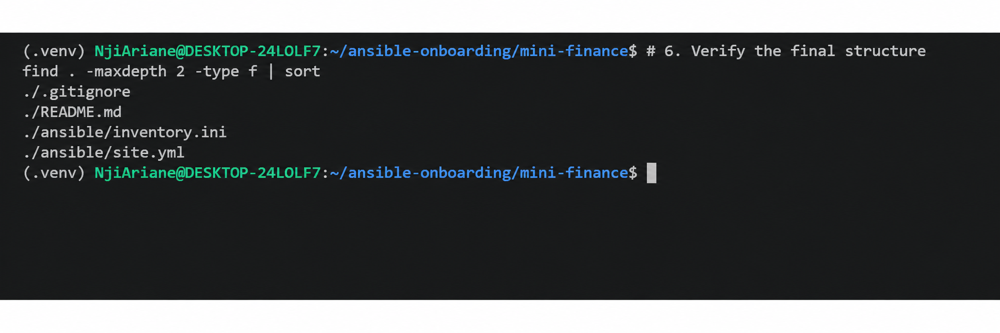

---

### Notes

Add your task notes here.

---

# Task 2 — Create the Azure Infrastructure Using Terraform

## Goal

Use Terraform to provision an Ubuntu Virtual Machine with the required Azure networking and security resources.

### Evidence

#### Screenshot 2 — Terraform code showing the `Allow-SSH` rule for port `22` and the `Allow-HTTP` rule for port `80`

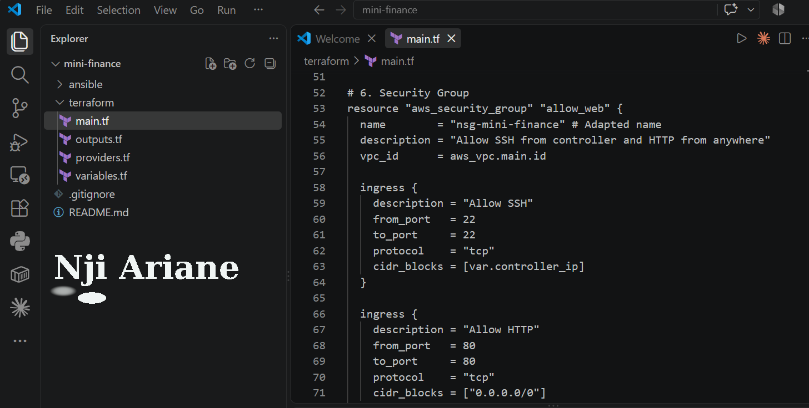

---

#### Screenshot 3 — Terraform code showing the association between `nsg-mini-finance` and `nic-mini-finance`

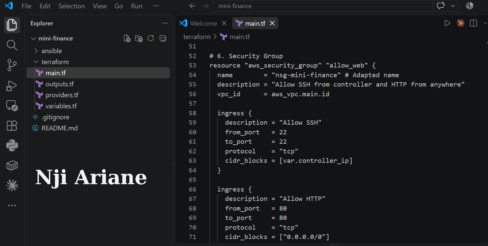

---

### Notes

Add your task notes here.

---

# Task 3 — Initialize and Apply the Terraform Configuration

## Goal

Format and validate the Terraform configuration, review the execution plan, and provision the Azure infrastructure.

### Evidence

#### Screenshot 4 — End of the `terraform apply` output showing `Apply complete!` with no errors

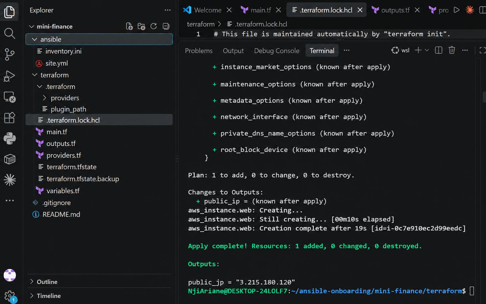

---

#### Screenshot 5 — Output of `terraform output public_ip` showing the VM’s public IP address

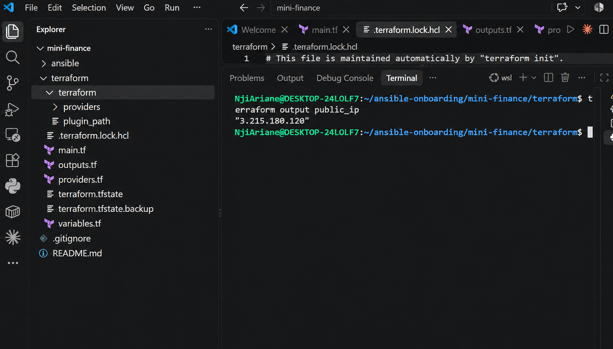

---

### Notes

Add your task notes here.

---

# Task 4 — Verify Passwordless SSH Access

## Goal

Confirm that the Ansible controller can connect to the Terraform-provisioned Azure VM using SSH key authentication.

### Evidence

#### Screenshot 6 — Passwordless SSH command and the returned `mini-finance` hostname

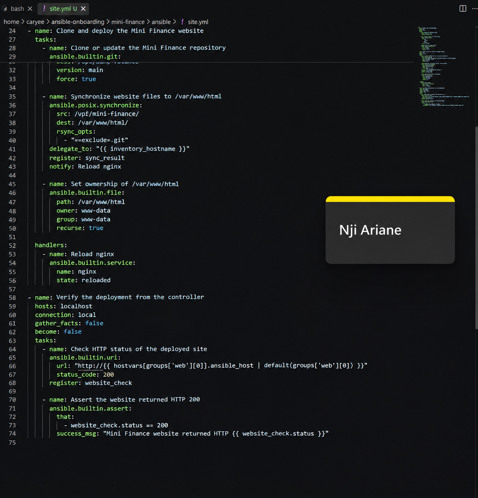

---

### Notes

Add your task notes here.

---

# Task 5 — Create the Ansible Inventory and Verify Connectivity

## Goal

Add the Terraform-provisioned Azure VM to the Ansible inventory and confirm that Ansible can connect to it.

### Evidence

#### Screenshot 7 — Ansible ping output showing `SUCCESS` and `pong` from the Azure VM

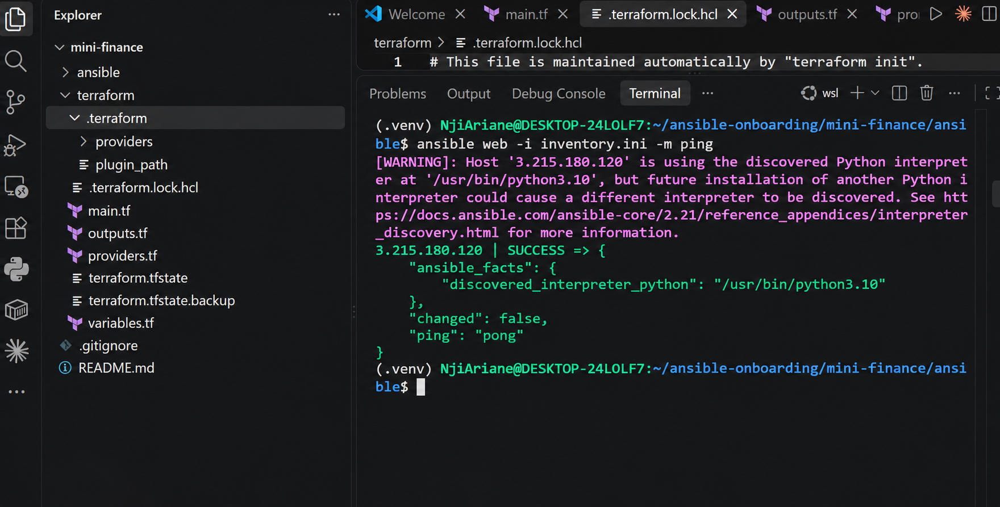

---

### Configuration File

Copy and paste the complete contents of your `ansible/inventory.ini` file below:

```ini
[web]
3.215.180.120

[web:vars]
ansible_user=ubuntu
ansible_ssh_private_key_file=~/.ssh/terraform-aws-vm-key
```

---

# Task 6 — Create the Multi-Play Ansible Playbook

## Goal

Create one Ansible playbook containing separate plays to install Nginx, deploy the Mini Finance website, and verify the deployment.

### Evidence

#### Screenshot 8 — `site.yml` showing Play 1 and the beginning of Play 2

Screenshot must show:

- Play 1 targeting the `web` group
- Installation of `nginx`, `git`, and `rsync`
- Nginx service configured as started and enabled
- Beginning of Play 2 with the Git repository URL and synchronization task

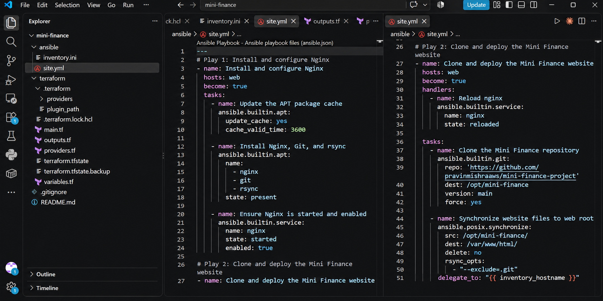

---

#### Screenshot 9 — `site.yml` showing the deployment destination, handler, and Play 3 verification

Screenshot must show:

- Website destination `/var/www/html/`
- Ownership set to `www-data:www-data`
- Nginx reload handler
- Play 3 targeting `localhost`
- The `uri` verification and `assert` condition

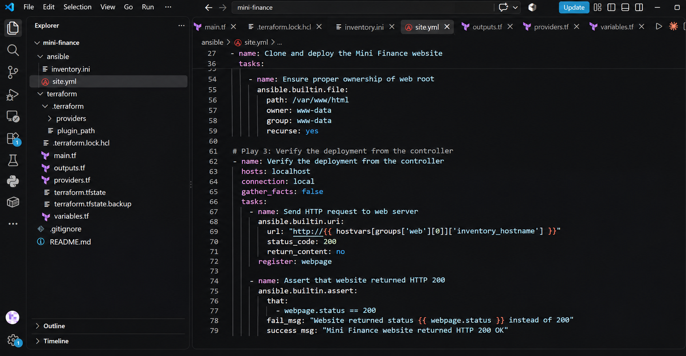

---

### Configuration File

Copy and paste the complete contents of your `ansible/site.yml` file below:


### Configuration File

Copy and paste the complete contents of your `ansible/site.yml` file below:

```yaml
---
# Play 1: Install and configure Nginx
- name: Install and configure Nginx
  hosts: web
  become: true
  tasks:
    - name: Update the APT package cache
      ansible.builtin.apt:
        update_cache: yes
        cache_valid_time: 3600

    - name: Install Nginx, Git, and rsync
      ansible.builtin.apt:
        name:
          - nginx
          - git
          - rsync
        state: present

    - name: Ensure Nginx is started and enabled
      ansible.builtin.service:
        name: nginx
        state: started
        enabled: true

# Play 2: Clone and deploy the Mini Finance website
- name: Clone and deploy the Mini Finance website
  hosts: web
  become: true
  handlers:
    - name: Reload nginx
      ansible.builtin.service:
        name: nginx
        state: reloaded

  tasks:
    - name: Clone the Mini Finance repository
      ansible.builtin.git:
        repo: 'https://github.com/pravinmishraaws/mini-finance-project'
        dest: /opt/mini-finance
        version: main
        force: yes

    - name: Synchronize website files to web root
      ansible.posix.synchronize:
        src: /opt/mini-finance/
        dest: /var/www/html/
        delete: no
        rsync_opts:
          - "--exclude=.git"
      delegate_to: "{{ inventory_hostname }}"
      notify: Reload nginx

    - name: Ensure proper ownership of web root
      ansible.builtin.file:
        path: /var/www/html
        owner: www-data
        group: www-data
        recurse: yes

# Play 3: Verify the deployment from the controller
- name: Verify the deployment from the controller
  hosts: localhost
  connection: local
  gather_facts: false
  tasks:
    - name: Send HTTP request to web server
      ansible.builtin.uri:
        url: "http://{{ hostvars[groups['web'][0]]['inventory_hostname'] }}"
        status_code: 200
        return_content: no
      register: webpage

    - name: Assert that website returned HTTP 200
      ansible.builtin.assert:
        that:
          - webpage.status == 200
        fail_msg: "Website returned status {{ webpage.status }} instead of 200"
        success_msg: "Mini Finance website returned HTTP 200 OK"
```

---

# Task 7 — Validate and Run the Ansible Playbook

## Goal

Validate the syntax of the multi-play Ansible playbook and run it to install Nginx, deploy the Mini Finance website, and verify the deployment.

### Evidence

#### Screenshot 10 — Successful playbook syntax check showing `playbook: site.yml`

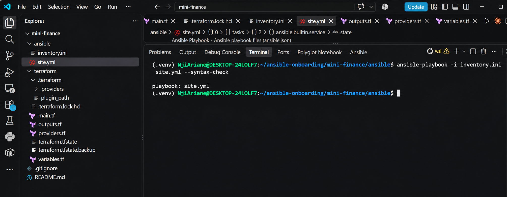

---

#### Screenshot 11 — Play 3 output showing the successful HTTP verification and assertion

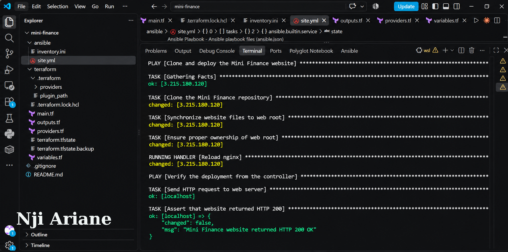

---

#### Screenshot 12 — Final `PLAY RECAP` showing `failed=0` and `unreachable=0`

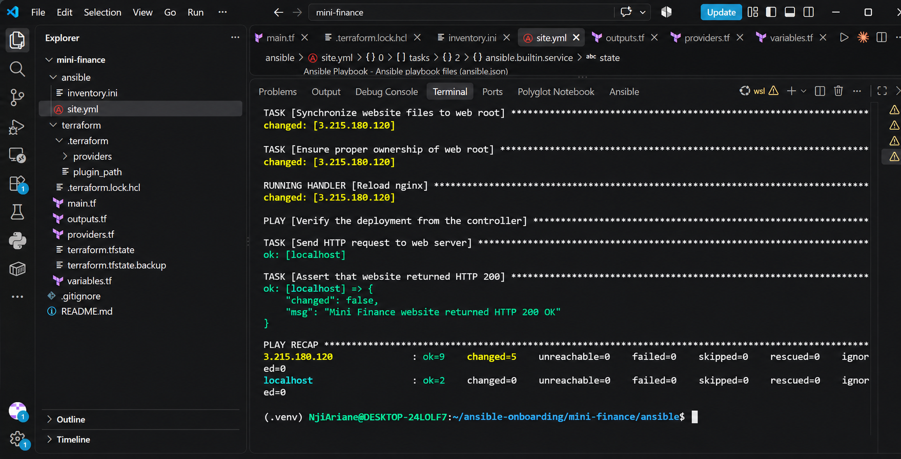

---

### Notes

Add your task notes here.

---

# Task 8 — Test the Mini Finance Website in a Browser

## Goal

Confirm that the Mini Finance website is publicly accessible through the Azure VM’s public IP address.

### Evidence

#### Screenshot 13 — Mini Finance website successfully loading in the browser, with the Azure VM’s public IP address visible in the address bar

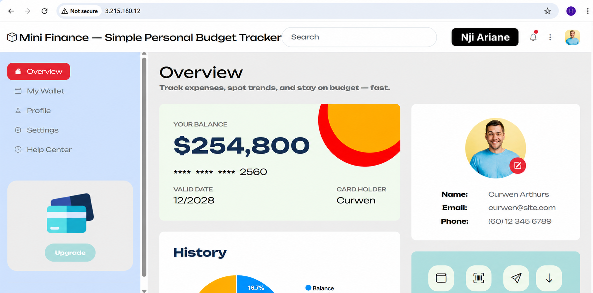

---

### Website URL

Add your deployed website URL below:

```text
http://3.215.180.120
```

---

# Task 9 — Create the Project README

## Goal

Create a `README.md` file to document the Mini Finance infrastructure and deployment project.

### Evidence

#### Screenshot 14 — Completed `README.md` displayed in the VS Code Markdown preview or terminal

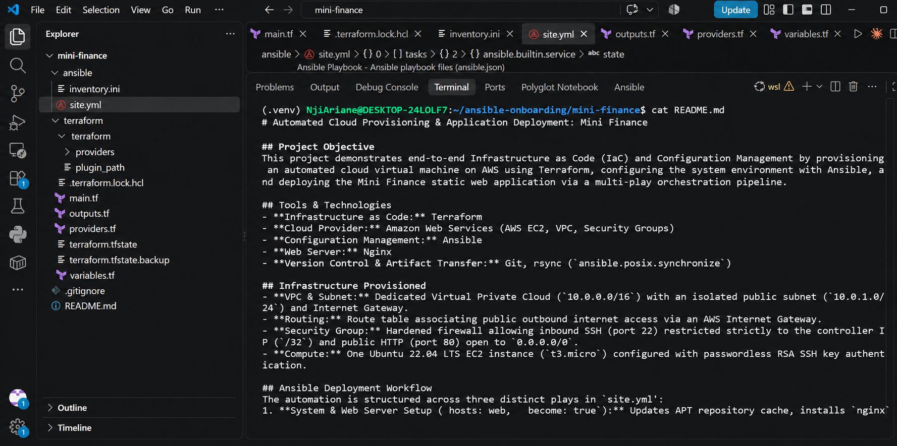

---

### README Content

Copy and paste the complete contents of your `README.md` file below:

# Automated Cloud Provisioning & Application Deployment: Mini Finance

## Project Objective
This project demonstrates end-to-end Infrastructure as Code (IaC) and Configuration Management by provisioning an automated cloud virtual machine on AWS using Terraform, configuring the system environment with Ansible, and deploying the Mini Finance static web application via a multi-play orchestration pipeline.

## Tools & Technologies
- **Infrastructure as Code:** Terraform
- **Cloud Provider:** Amazon Web Services (AWS EC2, VPC, Security Groups)
- **Configuration Management:** Ansible
- **Web Server:** Nginx
- **Version Control & Artifact Transfer:** Git, rsync (`ansible.posix.synchronize`)

## Infrastructure Provisioned
- **VPC & Subnet:** Dedicated Virtual Private Cloud (`10.0.0.0/16`) with an isolated public subnet (`10.0.1.0/24`) and Internet Gateway.
- **Routing:** Route table associating public outbound internet access via an AWS Internet Gateway.
- **Security Group:** Hardened firewall allowing inbound SSH (port 22) restricted strictly to the controller IP (`/32`) and public HTTP (port 80) open to `0.0.0.0/0`.
- **Compute:** One Ubuntu 22.04 LTS EC2 instance (`t3.micro`) configured with passwordless RSA SSH key authentication.

## Ansible Deployment Workflow
The automation is structured across three distinct plays in `site.yml`:
1. **System & Web Server Setup (`hosts: web`, `become: true`):** Updates APT repository cache, installs `nginx`, `git`, and `rsync`, and enables the Nginx daemon on boot.
2. **Application Delivery & Handler Execution (`hosts: web`, `become: true`):** Clones the source repository from GitHub into `/opt/mini-finance`, synchronizes web assets to `/var/www/html` excluding VCS files, ensures `www-data:www-data` ownership, and triggers an event-driven handler (`notify: Reload nginx`).
3. **Synthetic Integration Validation (`hosts: localhost`, `connection: local`):** Executes from the controller machine, polling the managed server's public IP over HTTP port 80 via `ansible.builtin.uri` and confirming an HTTP 200 status code with `ansible.builtin.assert`.

## Verification
- **Automated Validation:** Ansible verified synthetic reachability directly from `localhost`, asserting an HTTP 200 response from the instance's public IP.
- **Manual Verification:** Confirmed site availability and styling by navigating to `http://3.215.180.120` in a web browser.

## Challenges & Solutions
1. **Repository URL Discrepancy:** The initial playbook attempt pointed to `mini-finance-project`, which returned an HTTP 404 and caused Git to stall waiting for interactive credentials. By querying the GitHub API directly, I identified the canonical public repository URL as `mini_finance`, updated the playbook task, and resolved the hang.
2. **Provider Plugin Timeouts:** WSL encountered network timeouts while downloading the AWS Terraform provider. I resolved this by utilizing a local provider cache (`-plugin-dir`) and syncing the provider lock file from a verified workspace, avoiding external registry download stalls.

## Key Learnings
- **Tool Separation of Concerns:** Terraform manages immutable infrastructure lifecycle events (provisioning, network boundaries, security perimeters), while Ansible handles mutable runtime operations (package installation, artifact synchronization, service orchestration).
- **Event-Driven Handlers:** Using Ansible handlers prevents unnecessary service restarts by reloading Nginx only when source files actually change during synchronization.


---

# LinkedIn Post Required

## Evidence

#### Screenshot 15 — Published LinkedIn post showing the text and at least one deployment screenshot

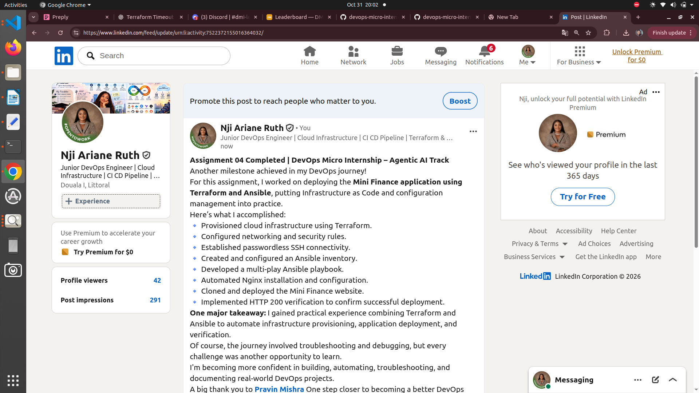
---

#### LinkedIn Post URL

Paste your LinkedIn post URL here:

https://lnkd.in/p/d-yGaXpU

---

### LinkedIn Submission Notes

**One challenge you faced and how you fixed it:**

One challenge I faced was configuring Ansible to communicate with the cloud virtual machine and deploy the website correctly. I addressed this by checking my inventory configuration, verifying SSH connectivity, and correcting the deployment configuration. I tested the connection using Ansible ping until it returned SUCCESS and pong, then successfully ran the playbook.

---

**One real-world example where you can use this learning:**

This knowledge can be applied when deploying and managing websites or applications across multiple cloud servers. For example, a company can use Terraform to provision its infrastructure and Ansible to automatically configure servers, install web services, and deploy applications without manually configuring each server.

---

# Assignment Questions

Answer the following in your own words:

**1. What did you provision using Terraform in this assignment?**

I used Terraform to provision the cloud infrastructure required to host the Mini Finance application. This included an AWS VPC, public subnet, Internet Gateway, route table, security group, and an Ubuntu EC2 virtual machine with a public IP address.


---

**2. What did Ansible configure and deploy in this assignment?**

Ansible was used to configure the virtual machine by updating the package cache, installing Nginx, Git, and rsync, and ensuring that Nginx was running and enabled. It also cloned the Mini Finance repository, synchronized the website files to /var/www/html/, configured file ownership, and reloaded Nginx.

---

**3. Why is SSH access on port `22` restricted to your public IP address?**

SSH access is restricted to my public IP address to prevent unauthorized users from accessing the server remotely. This reduces the attack surface and ensures that only trusted connections from my machine can manage the virtual machine.

---

**4. Why is HTTP port `80` open to the internet?**

HTTP port 80 is open to the internet because users need to access the Mini Finance website through their web browsers. Opening this port allows the Nginx web server to receive HTTP requests from visitors.

---

**5. What is the purpose of the Ansible inventory file?**

The Ansible inventory file contains information about the remote servers Ansible manages. It defines the target hosts, their groups, and connection details such as the server's IP address and SSH configuration. In this project, it identifies the cloud virtual machine under the web group.

---

**6. Why does the playbook use separate plays for install, deploy, and verify?**

The playbook uses separate plays to organize the deployment process into clear stages. The first play installs and configures the web server, the second deploys the Mini Finance application, and the third verifies that the website is accessible. This makes the automation easier to understand, troubleshoot, and maintain.

---

**7. Why is `rsync` useful when deploying website files?**

Rsync is useful because it efficiently synchronizes files between directories by transferring only the changes when possible. It reduces unnecessary file transfers, saves time, and helps ensure that the latest website files are deployed to the web server.

---

**8. What does the Ansible `uri` module verify in this assignment?**

The Ansible uri module sends an HTTP request to the deployed website and checks whether the web server returns the expected HTTP status code of 200. This confirms that the website is responding successfully. The assert task then checks that the returned status code is actually 200.

---

**9. What issue did you face during this assignment, and how did you fix it?**

One issue I encountered was getting the Ansible deployment and verification process working correctly. I approached it by checking the inventory configuration, confirming connectivity to the remote server, and reviewing the playbook tasks and deployment paths. After making the necessary corrections, I reran the playbook and successfully obtained an HTTP 200 response with zero failed and unreachable hosts.

---

**10. What did you learn from using Terraform and Ansible together?**

I learned that Terraform and Ansible complement each other in infrastructure automation. Terraform is responsible for provisioning the infrastructure, while Ansible handles server configuration and application deployment. Using both tools together makes the deployment process more consistent, repeatable, efficient, and easier to manage.

---

# Required Files

Confirm that the following files are included in your assignment folder:

- [x] `.gitignore`
- [x] `README.md`
- [x] `terraform/providers.tf`
- [x] `terraform/main.tf`
- [x] `terraform/variables.tf`
- [x] `terraform/outputs.tf`
- [x] `ansible/inventory.ini`
- [x] `ansible/site.yml`

---

# Submission Instructions

- Add all required screenshots in the correct order.
- Full Name must be visible in required screenshots.
- Add the Azure VM public IP address.
- Add the final Mini Finance website URL.
- Paste `inventory.ini`, `site.yml`, and `README.md` as editable text.
- Answer all assignment questions clearly in your own words.
- Add your LinkedIn post URL.
- Do not expose SSH private keys, passwords, Azure credentials, subscription IDs, Terraform state contents, or other sensitive information.

---

# Completion Checklist

- [x] Task 1: `mini-finance` project structure created
- [x] Task 1: `.gitignore` created
- [x] Task 2: Terraform Azure infrastructure code created
- [x] Task 2: `Allow-SSH` rule configured for port `22`
- [x] Task 2: `Allow-HTTP` rule configured for port `80`
- [x] Task 2: NSG associated with the Network Interface
- [x] Task 3: `terraform fmt` completed
- [x] Task 3: `terraform init` completed
- [x] Task 3: `terraform validate` completed successfully
- [x] Task 3: `terraform apply` completed successfully
- [x] Task 3: `terraform output public_ip` displayed the VM public IP
- [x] Task 4: Passwordless SSH works from the Ansible controller
- [x] Task 5: `inventory.ini` created
- [x] Task 5: Ansible ping returns `SUCCESS` and `pong`
- [x] Task 6: `site.yml` contains three separate plays
- [x] Task 6: Play 1 installs Nginx, Git, and rsync
- [x] Task 6: Play 2 clones and deploys the Mini Finance website
- [x] Task 6: Play 3 verifies HTTP status code `200`
- [x] Task 7: Playbook syntax check passes
- [x] Task 7: Ansible playbook completes successfully
- [x] Task 7: Final recap shows `failed=0` and `unreachable=0`
- [x] Task 8: Mini Finance website loads in the browser
- [x] Task 8: Azure VM public IP is visible in the browser screenshot
- [x] Task 9: `README.md` completed
- [x] Screenshots 1–15 are included
- [x] `inventory.ini`, `site.yml`, and `README.md` are pasted as editable text
- [x] Assignment questions are answered
- [x] LinkedIn post published with Anyone visibility
- [x] LinkedIn post URL added
- [x] No sensitive information is exposed

---

## About DMI & CloudAdvisory

DevOps Micro Internship (DMI) is a project-based DevOps program run by Pravin Mishra and The CloudAdvisory, focused on real-world execution, systems thinking, and career readiness.

It helps learners build strong DevOps foundations with hands-on experience.

---

## Resources

- DMI Official Website: [https://dmi.pravinmishra.com?utm_source=github&utm_medium=readme](https://dmi.pravinmishra.com?utm_source=github&utm_medium=readme)
- University: [https://university.pravinmishra.com?utm_source=github&utm_medium=readme](https://university.pravinmishra.com?utm_source=github&utm_medium=readme)
- Discord Community: [https://discord.pravinmishra.com?utm_source=github&utm_medium=readme](https://discord.pravinmishra.com?utm_source=github&utm_medium=readme)
- Blog: [https://dmi.pravinmishra.com/blog?utm_source=github&utm_medium=readme](https://dmi.pravinmishra.com/blog?utm_source=github&utm_medium=readme)
- YouTube Playlist: [https://www.youtube.com/playlist?list=PLFeSNDtI4Cho](https://www.youtube.com/playlist?list=PLFeSNDtI4Cho)
- Pravin Mishra LinkedIn: [https://www.linkedin.com/in/pravin-mishra-aws-trainer/](https://www.linkedin.com/in/pravin-mishra-aws-trainer/)
- CloudAdvisory LinkedIn: [https://www.linkedin.com/company/thecloudadvisory/](https://www.linkedin.com/company/thecloudadvisory/)

---

*This submission is part of DevOps Micro Internship (DMI) — Agentic AI Track.*