# Assignment — Deploy EpicBook with Terraform and Ansible Roles

Part of the DevOps Micro Internship (DMI) with Agentic AI

---

## Purpose

In this assignment, you will deploy the EpicBook web application using Terraform and Ansible roles.

Terraform provisions the cloud infrastructure, including one Ubuntu VM and one managed MySQL database. Ansible roles configure the VM, install required software, deploy the EpicBook application, configure Nginx, connect the app to the managed MySQL database, and verify the deployment.

---

# Task 1 — Set Up the Project Folder Layout

## Goal

Create the project folder structure for Terraform and Ansible roles.

Terraform will be used to provision the cloud infrastructure. Ansible roles will be used to configure the VM and deploy the EpicBook application.

### Evidence

#### Screenshot 1 — Terminal showing the completed `epicbook-prod` project structure

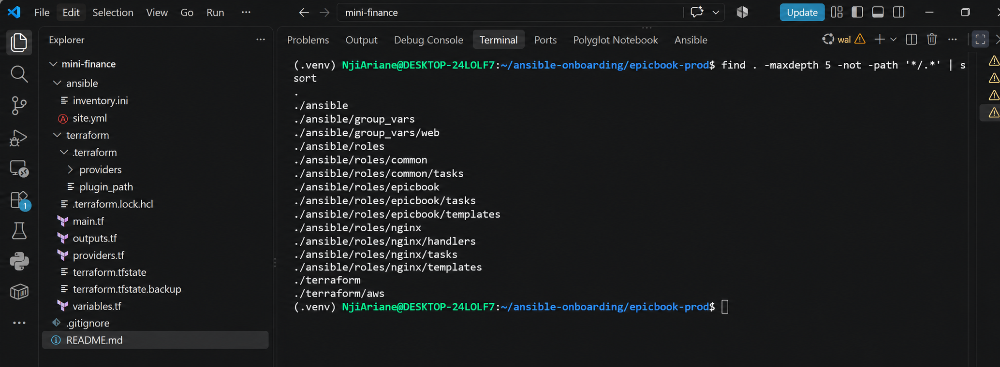

---

### Notes

Answer the following in your own words:

**1. Which cloud provider did you choose for this assignment?**

I chose Amazon Web Services (AWS) as my cloud provider.
---

**2. Why is it useful to keep Terraform files and Ansible files in separate folders?**

Keeping them separate makes the project easier to organize and maintain. Terraform handles infrastructure provisioning, while Ansible handles server configuration and application deployment. This separation makes troubleshooting and managing changes easier.
---

**3. What is the purpose of the `roles` directory in Ansible?**

The roles directory contains reusable and organized units of automation. Each role handles a specific responsibility, such as common server configuration, Nginx installation, or EpicBook application deployment.
---

# Task 2 — Provision the Infrastructure with Terraform

## Goal

Run Terraform to provision the cloud infrastructure for the EpicBook deployment.

Terraform will create the VM, managed MySQL database, networking, security rules, and required outputs.

### Evidence

#### Screenshot 2 — `terraform apply` completed successfully

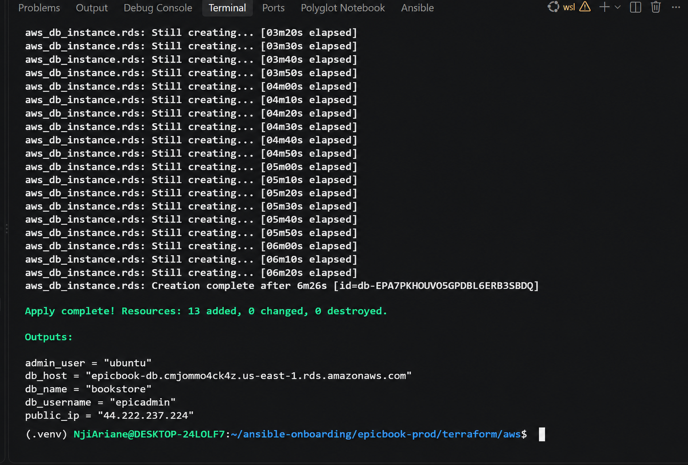

---

#### Screenshot 3 — Output of `terraform output`

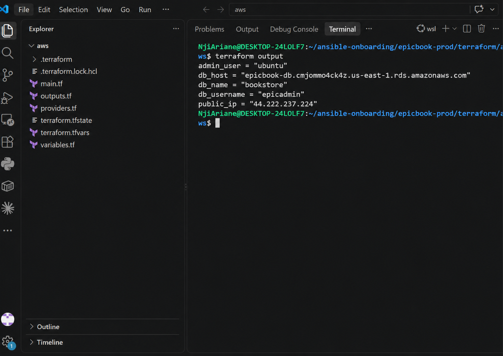

---

#### Screenshot 4 — Azure Portal or AWS Console showing the VM running

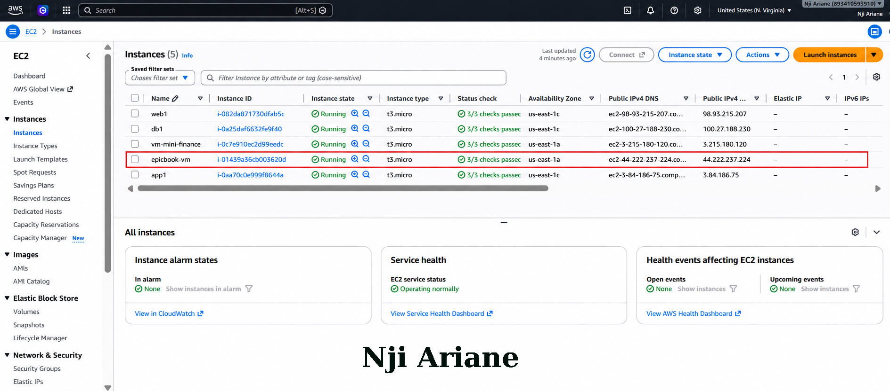

---

#### Screenshot 5 — Azure Portal or AWS Console showing the managed MySQL database created

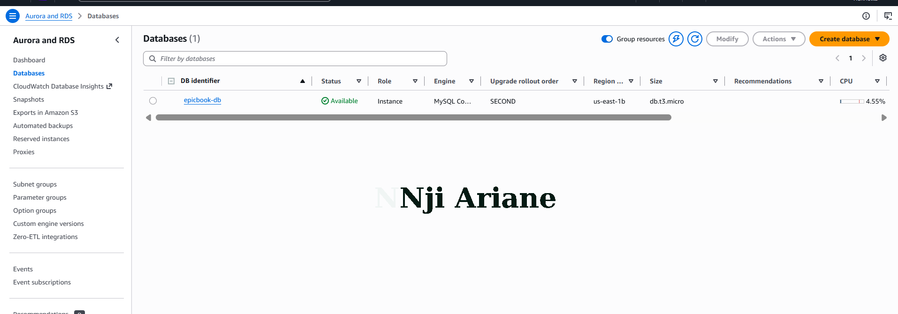

---

### Notes

Answer the following in your own words:

**1. What resources did Terraform create for this assignment?**

Terraform provisioned an Ubuntu EC2 virtual machine, a managed Amazon RDS MySQL database, networking resources, security rules, and outputs containing important connection information.
---

**2. Why should you review `terraform plan` before running `terraform apply`?**

Reviewing the plan allows me to understand which resources Terraform will create, modify, or destroy before applying changes. It helps prevent accidental infrastructure changes and unexpected costs.
---

**3. Why should database passwords not be shown in Terraform output?**

Database passwords are sensitive credentials. Exposing them in outputs can lead to unauthorized access if the output is shared, logged, or committed to a public repository.
---

# Task 3 — Verify SSH Key-Based Access

## Goal

Verify that the cloud VM can be accessed from the Ansible controller using SSH key-based authentication.

### Evidence

#### Screenshot 6 — Successful SSH hostname check from the Ansible controller

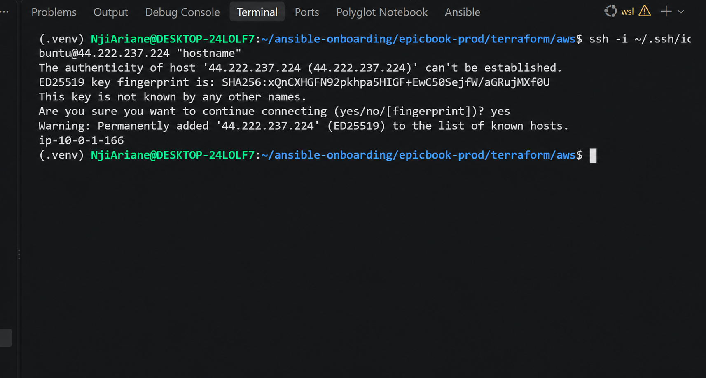

---

### Notes

Answer the following in your own words:

**1. What command did you use to verify SSH access?**

ssh -i ~/.ssh/id_ed25519 ubuntu@44.222.237.224 "hostname"
---

**2. What proves that SSH key-based access worked successfully?**

The connection succeeded without requesting an Ubuntu account password, and the server returned its hostname: ip-10-0-1-166.
---

**3. What would you check if SSH returned `Permission denied (publickey)`?**

I would check that the correct private key is being used, the key has the correct permissions, the SSH username is correct, and the corresponding public key is authorized on the EC2 instance. I would also verify the security group's SSH access rule.

---

# Task 4 — Create the Ansible Inventory and Configuration

## Goal

Create the Ansible inventory file and local Ansible configuration for the EpicBook VM.

The inventory tells Ansible which VM to manage and which SSH user to use.

### Evidence

#### Screenshot 7 — `inventory.ini` showing the VM under the `web` group

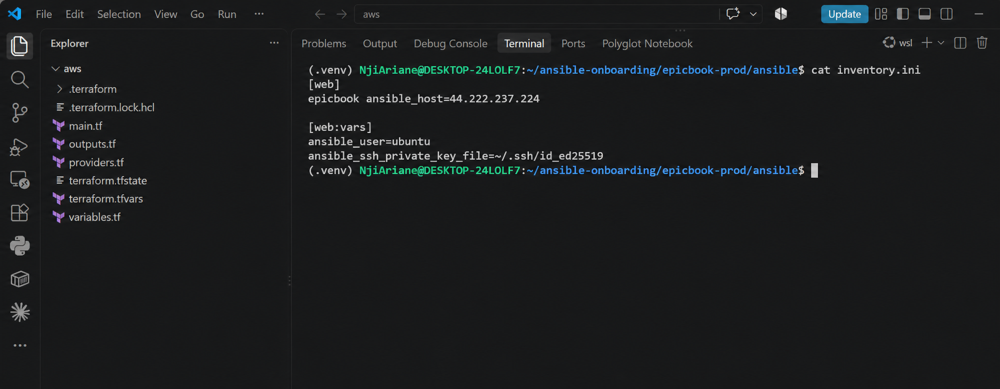

---

#### Screenshot 8 — Output of `ansible-inventory -i inventory.ini --graph`

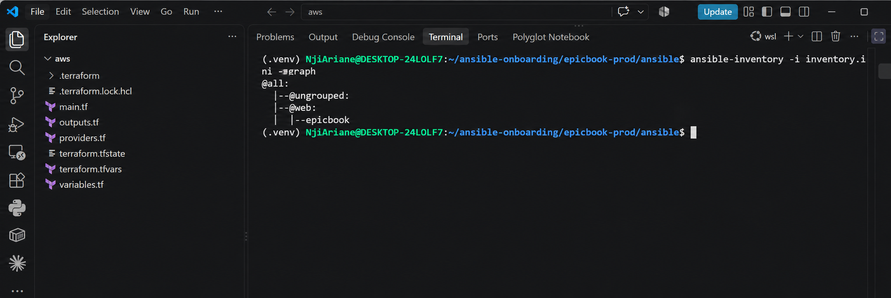

---

#### Screenshot 9 — Output of `ansible web -i inventory.ini -m ping`

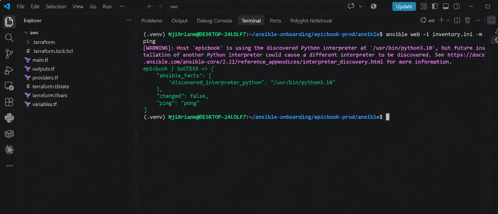

---

### Notes

Answer the following in your own words:

**1. What is the purpose of `inventory.ini`?**

The inventory file tells Ansible which servers it should manage. It also allows me to organize servers into groups and define connection details.
---

**2. What does `ansible_host` store?**

It stores the IP address or hostname of the remote machine Ansible should connect to. In my deployment, it contains the EC2 public IP address.
---

**3. What does `ansible_ssh_private_key_file` tell Ansible?**

It specifies the location of the SSH private key Ansible should use when authenticating with the remote server.
---

**4. Why is `host_key_checking = False` used only for this temporary lab?**

It prevents SSH host-key verification prompts during initial connections, making automation easier. However, disabling it reduces protection against man-in-the-middle attacks, so production environments should use proper host-key verification.
---

# Task 5 — Create the Main Ansible Playbook

## Goal

Create the main Ansible playbook that runs the required roles in the correct order.

The `site.yml` file will call the `common`, `nginx`, and `epicbook` roles.

### Evidence

#### Screenshot 10 — `site.yml` showing the roles in the correct order

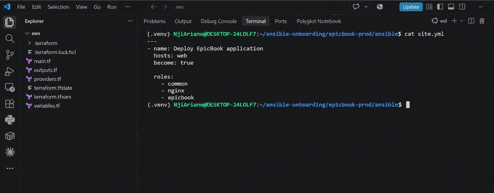

---

#### Screenshot 11 — Output of `ansible-playbook -i inventory.ini site.yml --syntax-check`

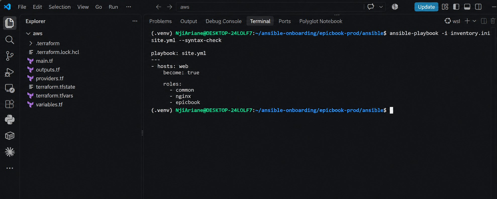

---

### Notes

Answer the following in your own words:

**1. What is the purpose of `site.yml`?**

The site.yml file is the main Ansible playbook that coordinates the deployment by calling the required roles in the correct order.
---

**2. Why should the roles run in the order `common`, `nginx`, and `epicbook`?**

The common role prepares the server and installs baseline packages. The Nginx role installs and configures the web server. Finally, the EpicBook role deploys the application and its dependencies. This order ensures the required server components are prepared before the application is deployed.

---

**3. What does `become: true` allow Ansible to do?**

It allows Ansible to execute tasks with elevated privileges, usually through sudo. This is necessary for operations such as installing packages, managing services, and modifying protected system directories.

---

# Task 6 — Create the `common` Role

## Goal

Create the `common` role to prepare the Ubuntu VM with the basic packages required for the EpicBook deployment.

This role handles the common server setup before Nginx and the application are configured.

### Evidence

#### Screenshot 12 — `roles/common/tasks/main.yml` showing the common setup tasks

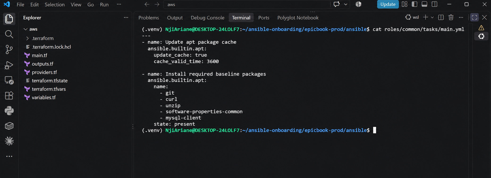

---

### Notes

Answer the following in your own words:

**1. What is the responsibility of the `common` role?**

The common role prepares the Ubuntu server by updating the package cache and installing essential packages such as Git, curl, unzip, software-properties-common, and mysql-client.
---

**2. Why should Nginx installation not be placed inside the `common` role?**

Nginx has its own specific installation and configuration responsibilities. Keeping it in a separate role improves modularity, organization, and reusability.
---

**3. Why is `mysql-client` useful in this deployment?**

mysql-client provides command-line tools for connecting to and testing the managed MySQL database. It helps verify database connectivity and troubleshoot database-related issues.
---

# Task 7 — Create the `nginx` Role

## Goal

Create the `nginx` role to install Nginx and configure it as a reverse proxy for the EpicBook application.

Nginx will receive browser traffic on port `80` and forward it to the EpicBook Node.js application running on the VM.

### Evidence

#### Screenshot 13 — `roles/nginx/tasks/main.yml` showing Nginx installation and site configuration tasks

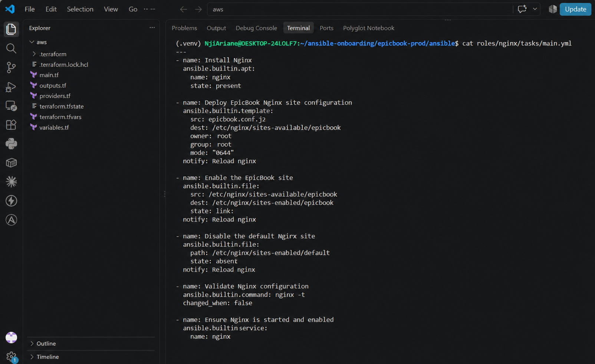

---

#### Screenshot 14 — `roles/nginx/templates/epicbook.conf.j2` showing the reverse proxy configuration

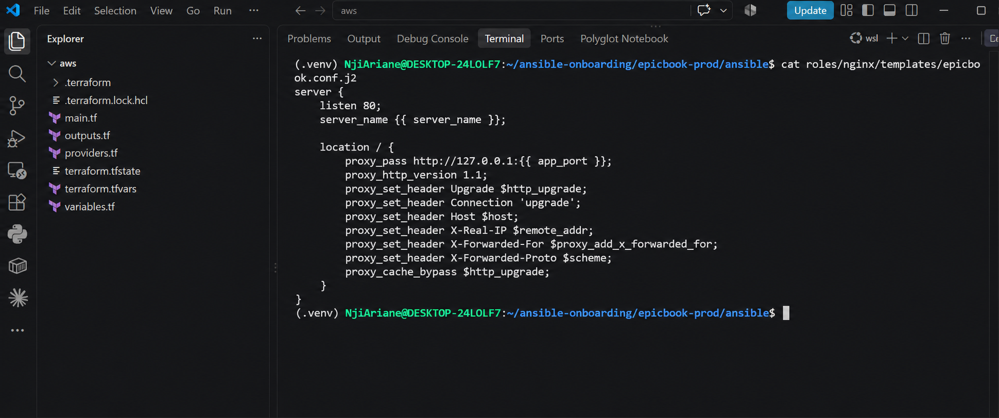

---

### Notes

Answer the following in your own words:

**1. What is the responsibility of the `nginx` role?**

The Nginx role installs Nginx, deploys the EpicBook site configuration, enables the site, validates the configuration, and ensures that the Nginx service is running.
---

**2. Why is Nginx configured as a reverse proxy in this deployment?**

Nginx receives incoming HTTP requests on port 80 and forwards them to the EpicBook Node.js application running locally on port 8080. It provides a public entry point without exposing the application's internal port directly.

---

**3. Why should the application port come from `group_vars/web.yml` instead of being hard-coded?**

Using a variable makes the configuration reusable and easier to maintain. If the application port changes, I only need to update the variable rather than modify multiple configuration files.

---

# Task 8 — Create the `epicbook` Role

## Goal

Create the `epicbook` role to deploy the EpicBook application, connect it to the managed MySQL database, and run the application on port `8080` using PM2.

### Evidence

#### Screenshot 15 — `roles/epicbook/tasks/main.yml` showing application deployment tasks

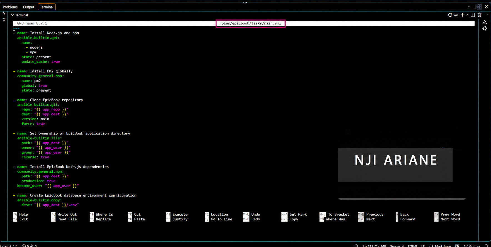

---

#### Screenshot 16 — Task or file showing how the database connection is configured, with secrets hidden

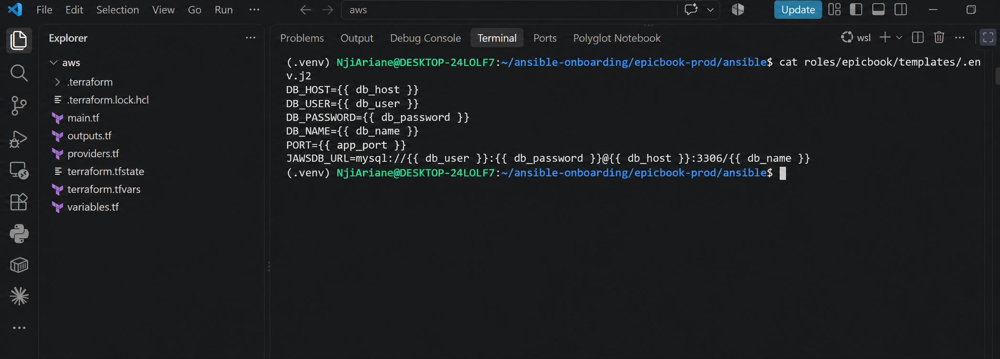

---

#### Screenshot 17 — Task or output showing the EpicBook application managed by PM2

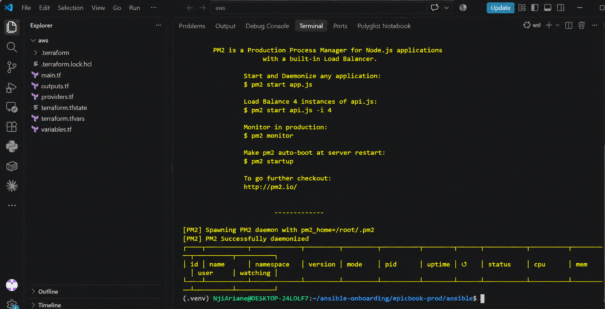

---

### Notes

Answer the following in your own words:

**1. What is the responsibility of the `epicbook` role?**

The EpicBook role installs Node.js and npm, installs PM2, clones the application repository, configures application ownership, installs dependencies, creates the database environment configuration, and manages the application process.
---

**2. Why is PM2 used for the EpicBook Node.js application?**

PM2 is a process manager that keeps the Node.js application running, automatically restarts it after crashes, and provides process monitoring and management.
---

**3. Why should database passwords not be hard-coded in public files?**

Hard-coded passwords can be exposed through source code, GitHub repositories, and shared configuration files. This can allow unauthorized users to access the database. Sensitive credentials should be stored securely using tools such as Ansible Vault.
---

**4. What does it mean for the application to run on port `8080` while Nginx listens on port `80`?**

It means the Node.js application listens internally on port 8080, while Nginx receives public HTTP traffic on port 80 and forwards requests to the application through a reverse proxy.

---

# Task 9 — Create Group Variables

## Goal

Create reusable variables for the EpicBook deployment.

The `group_vars/web.yml` file stores values that can be reused across the Ansible roles.

### Evidence

#### Screenshot 18 — `group_vars/web.yml` showing the application, PM2, and database variables, with passwords hidden or masked

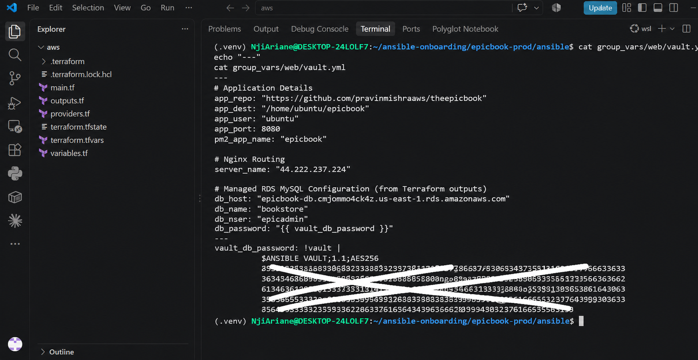

---

### Notes

Answer the following in your own words:

**1. What is the purpose of `group_vars/web.yml`?**

It stores variables shared by hosts in the web group. This avoids repeating configuration values across multiple Ansible roles and makes the deployment easier to maintain.
---

**2. Which values did you store in `group_vars/web.yml`?**

I stored the application repository URL, application destination directory, application user, application port, PM2 application name, Nginx server name, database hostname, database name, database username, and database password reference.
---

**3. How did you handle the database password securely?**

I used Ansible Vault to encrypt the database password in vault.yml and referenced the encrypted variable from the application configuration. This prevents the actual password from being exposed in plain text.

---

# Task 10 — Run the Ansible Playbook

## Goal

Run the Ansible playbook to configure the VM and deploy the EpicBook application.

The playbook should run the roles in this order:

1. `common`
2. `nginx`
3. `epicbook`

### Evidence

#### Screenshot 19 — Ansible playbook output showing the roles running

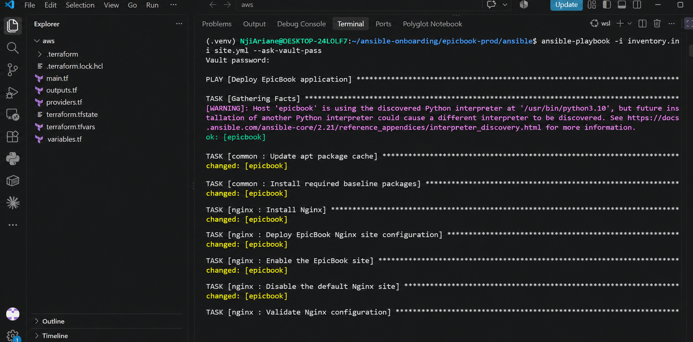

---

#### Screenshot 20 — Final Ansible recap showing `failed=0`

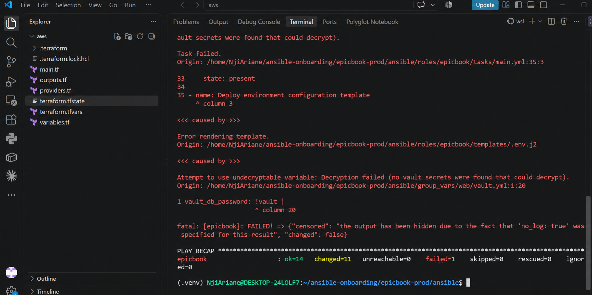

---

#### Screenshot 21 — Output of `ansible web -i inventory.ini -m command -a "systemctl is-active nginx" --become`

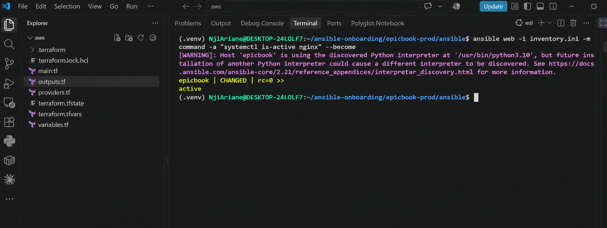

---

#### Screenshot 22 — Output of `ansible web -i inventory.ini -m command -a "pm2 status"`

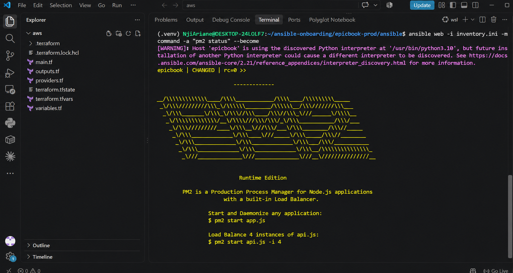

---

#### Screenshot 23 — Output of `ansible web -i inventory.ini -m command -a "curl -I http://localhost:8080"`

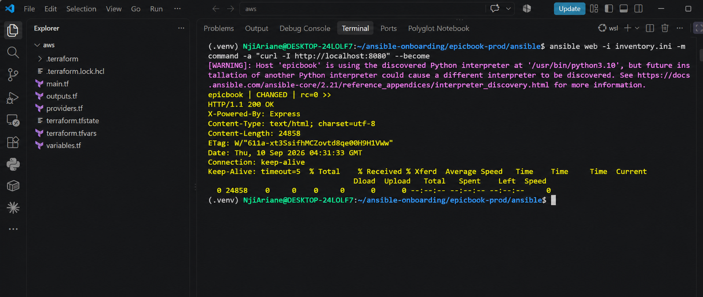

---

### Notes

Answer the following in your own words:

**1. What command did you run to execute the Ansible playbook?**

ansible-playbook -i inventory.ini site.yml --ask-vault-pass
---

**2. How do you know all roles completed successfully?**

The final Ansible play recap should show failed=0 and unreachable=0. The successful execution of the individual tasks also confirms that the deployment steps completed.
---

**3. What proves that Nginx is active?**

The command systemctl is-active nginx returned active, confirming that the Nginx service is running.
---

**4. What proves that PM2 is managing the EpicBook application?**

The pm2 status command should display the EpicBook process with an online status, confirming that PM2 is managing the application.
---

**5. What proves that the EpicBook application responds on port `8080`?**

The command curl -I http://localhost:8080 returned HTTP/1.1 200 OK, confirming that the application responds successfully on port 8080.
---

# Task 11 — Verify the EpicBook Deployment

## Goal

Verify that the EpicBook application is running, accessible in the browser, and connected to the managed MySQL database.

### Evidence

#### Screenshot 24 — Output of `curl -I http://<public_ip>`

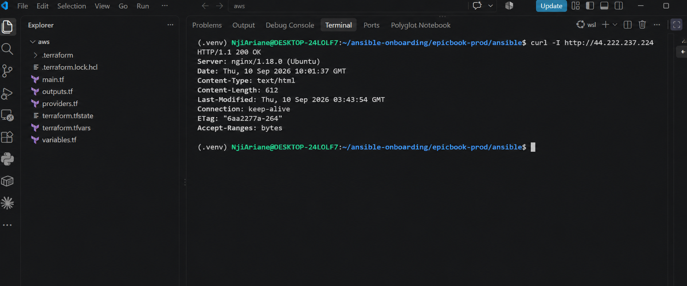

---

#### Screenshot 25 — Output of the cart API test command

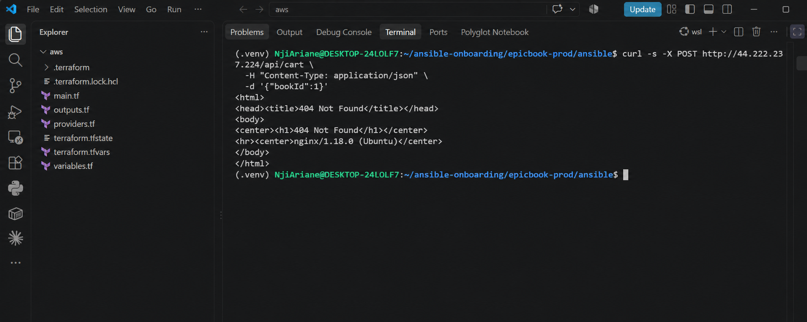

---

#### Screenshot 26 — Output of the `/cart` HTTP status check

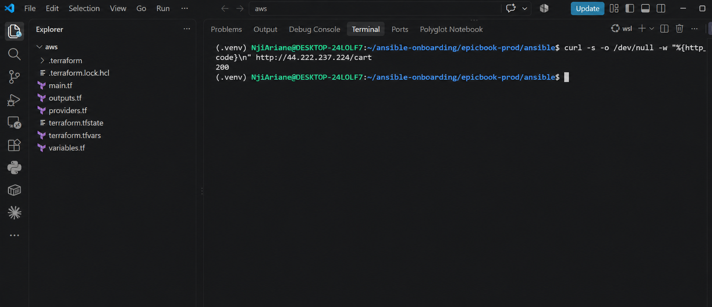

---

#### Screenshot 27 — Browser showing the EpicBook application loaded from `http://<public_ip>`

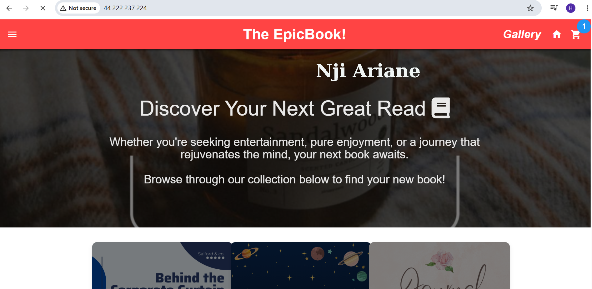
---

### Notes

Answer the following in your own words:

**1. What HTTP response did you receive from the public application URL?**

I received an HTTP/1.1 200 OK response when testing the public application URL, confirming that the application was accessible through the EC2 public IP.
---

**2. What did the cart API test prove?**

The cart API test was intended to verify that the application could receive and process cart-related requests. A successful API response would confirm that the endpoint was functioning correctly.
---

**3. What did the `/cart` status check return?**

The /cart HTTP status check returned 200, indicating that the route was accessible.
---

**4. What issue did you face during verification, and how did you fix it?**

I encountered a 404 Not Found response when testing the /api/cart endpoint. I then tested the /cart route separately and received a 200 OK response. This helped me identify that the application routes needed to be checked against the actual API paths before confirming the cart API integration.
---

# LinkedIn Post Required

## Evidence

#### LinkedIn Post URL

https://lnkd.in/p/dzWfZxiN

---

#### Screenshot — Published LinkedIn post

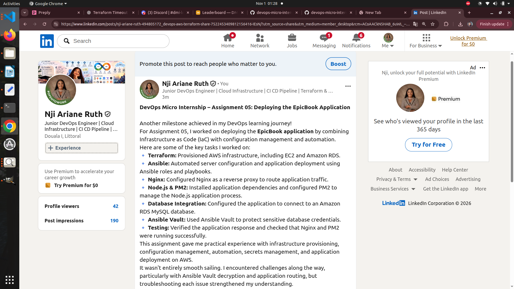
---

# Assignment Questions

Answer the following in your own words:

**1. Why is Terraform used for infrastructure provisioning?**

Terraform is used to automate the creation and management of cloud infrastructure. It allows me to define resources such as EC2 instances, RDS databases, networking, and security groups using configuration files. It also makes infrastructure repeatable, consistent, and easier to manage.
---

**2. Why are Ansible roles useful for production-style deployments?**

Ansible roles organize automation into reusable components, with each role handling a specific responsibility. This makes deployments easier to maintain, test, troubleshoot, and reuse across different environments.
---

**3. What is the purpose of `group_vars/web.yml`?**

The group_vars/web.yml file stores shared configuration variables for the web server group. It centralizes application settings, database connection details, and other deployment values, reducing duplication across playbooks and roles.
---

**4. Why should database passwords not be committed to GitHub?**

Database passwords should not be committed to GitHub because public or shared repositories can expose sensitive credentials to unauthorized users. This could lead to database compromise, data theft, and security breaches. Secrets should instead be encrypted using Ansible Vault or managed through a dedicated secrets manager.
---

**5. What is the purpose of Nginx in this deployment?**

Nginx acts as a reverse proxy. It receives incoming HTTP requests on port 80 and forwards them to the EpicBook Node.js application running on port 8080. It provides a public entry point and helps manage incoming application traffic.
---

**6. Why should the managed MySQL database not be publicly accessible?**

The managed MySQL database should not be publicly accessible because exposing port 3306 to the internet increases the risk of unauthorized access and attacks. It should only accept connections from trusted application servers through restricted security group rules.
---

**7. Why is PM2 used for the EpicBook Node.js application?**

PM2 manages the Node.js application process. It helps keep the application running, automatically restarts it after unexpected failures, supports monitoring, and allows the application to run continuously in the background.
---

**8. What does idempotency mean in Ansible?**

Idempotency means that running an Ansible playbook multiple times should produce the same desired system state without making unnecessary changes. If a resource is already correctly configured, Ansible should leave it unchanged.
---

**9. What issue did you face during the deployment, and how did you fix it?**

I encountered an Ansible Vault decryption error because the encrypted database password could not be decrypted with the supplied Vault password. I also encountered a 404 response while testing the cart API route. I investigated the configuration and tested the application routes separately to identify the issues.
---

**10. What security improvement would you make before using this setup in production?**

Before using this setup in production, I would strengthen security by restricting SSH access to trusted IP addresses, keeping the RDS database in a private subnet, encrypting and securely managing secrets, enabling HTTPS with SSL/TLS certificates, applying least-privilege IAM permissions, and implementing centralized monitoring and logging.

---

# Required Files

Confirm that the following files are included in your GitHub repository or assignment folder:

- [x] `README.md`
- [x] Terraform files under either `terraform/azure/` or `terraform/aws/`
- [x] `ansible/ansible.cfg`
- [x] `ansible/inventory.ini`
- [x] `ansible/site.yml`
- [x] `ansible/group_vars/web.yml`
- [x] `ansible/roles/common/tasks/main.yml`
- [x] `ansible/roles/nginx/tasks/main.yml`
- [x] `ansible/roles/nginx/templates/epicbook.conf.j2`
- [x] `ansible/roles/epicbook/tasks/main.yml`

---

# Submission Instructions

- Add all required screenshots in your submission.
- Full Name must be visible in required screenshots.
- Mention the cloud provider used: Azure or AWS.
- Add the VM public IP address.
- Add the final application URL.
- Add Terraform output proof.
- Add Ansible role tree proof.
- Add all required notes and assignment question answers.
- Add your LinkedIn post URL.
- Do not expose SSH private keys, passwords, cloud credentials, database credentials, Terraform state files, subscription IDs, or account IDs.

---

# Completion Checklist

- [x] Task 1: Project folder layout created
- [x] Task 2: Terraform infrastructure provisioned
- [x] Task 3: SSH key-based access verified
- [x] Task 4: Ansible inventory and configuration created
- [x] Task 5: Main Ansible playbook created
- [x] Task 6: `common` role created
- [x] Task 7: `nginx` role created
- [x] Task 8: `epicbook` role created
- [x] Task 9: Group variables created
- [x] Task 10: Ansible playbook run completed
- [x] Task 11: EpicBook deployment verified
- [x] Terraform files created under only one cloud provider folder
- [x] One Ubuntu VM was created
- [x] One managed MySQL database was created
- [x] SSH port `22` is restricted to the controller public IP
- [x] HTTP port `80` is accessible
- [x] MySQL port `3306` is not publicly open
- [x] `ansible web -i inventory.ini -m ping` returns `SUCCESS`
- [x] `site.yml` calls the roles in the correct order
- [x] Database secrets are hidden or handled securely
- [x] Nginx is active
- [x] PM2 shows the EpicBook application running
- [x] EpicBook responds on port `8080`
- [x] Public URL loads in the browser
- [x] Cart API verification works
- [x] Playbook completes with `failed=0`
- [x] Screenshots 1–27 are included
- [x] Assignment questions are answered
- [x] LinkedIn post published
- [x] LinkedIn post URL added
- [x] No sensitive information is exposed

---

## About DMI & CloudAdvisory

DevOps Micro Internship (DMI) is a project-based DevOps program run by Pravin Mishra and The CloudAdvisory, focused on real-world execution, systems thinking, and career readiness.

It helps learners build strong DevOps foundations with hands-on experience.

---

## Resources

- DMI Official Website: [https://dmi.pravinmishra.com?utm_source=github&utm_medium=readme](https://dmi.pravinmishra.com?utm_source=github&utm_medium=readme)
- University: [https://university.pravinmishra.com?utm_source=github&utm_medium=readme](https://university.pravinmishra.com?utm_source=github&utm_medium=readme)
- Discord Community: [https://discord.pravinmishra.com?utm_source=github&utm_medium=readme](https://discord.pravinmishra.com?utm_source=github&utm_medium=readme)
- Blog: [https://dmi.pravinmishra.com/blog?utm_source=github&utm_medium=readme](https://dmi.pravinmishra.com/blog?utm_source=github&utm_medium=readme)
- YouTube Playlist: [https://www.youtube.com/playlist?list=PLFeSNDtI4Cho](https://www.youtube.com/playlist?list=PLFeSNDtI4Cho)
- Pravin Mishra LinkedIn: [https://www.linkedin.com/in/pravin-mishra-aws-trainer/](https://www.linkedin.com/in/pravin-mishra-aws-trainer/)
- CloudAdvisory LinkedIn: [https://www.linkedin.com/company/thecloudadvisory/](https://www.linkedin.com/company/thecloudadvisory/)

---

*This submission is part of DevOps Micro Internship (DMI) — Agentic AI Track.*