# Assignment 6 — AI-Assisted Ansible Change Risk Review

Part of the DevOps Micro Internship (DMI) with Agentic AI

---

## Purpose

In this assignment, you will build an AI-assisted Ansible risk-review workflow using `ansible-playbook --check --diff`, Bash scripting, and Claude Code.

You will review possible server changes before applying them, classify risky tasks, and keep the final apply decision under human control.

---

# Task 1 — Confirm EpicBook Connectivity and Create the Workspace

## Goal

Confirm that your previous EpicBook Ansible project is working before creating the risk-review automation.

### Evidence

#### Screenshot 1 — Output of `ansible web -i inventory.ini -m ping`

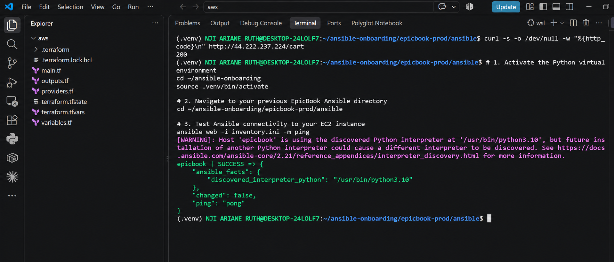

---

#### Screenshot 2 — Output of `ansible-playbook -i inventory.ini site.yml --syntax-check`

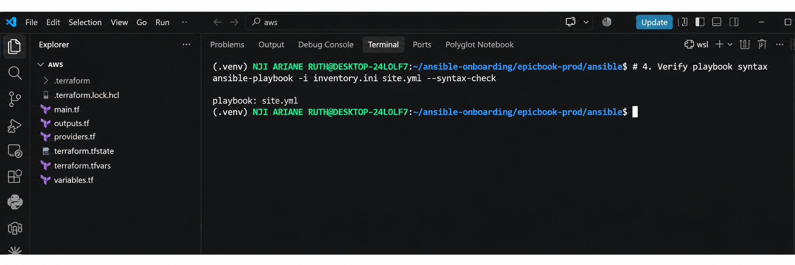

---

#### Screenshot 3 — Output of `pwd` and `find . -maxdepth 4 -type d | sort`

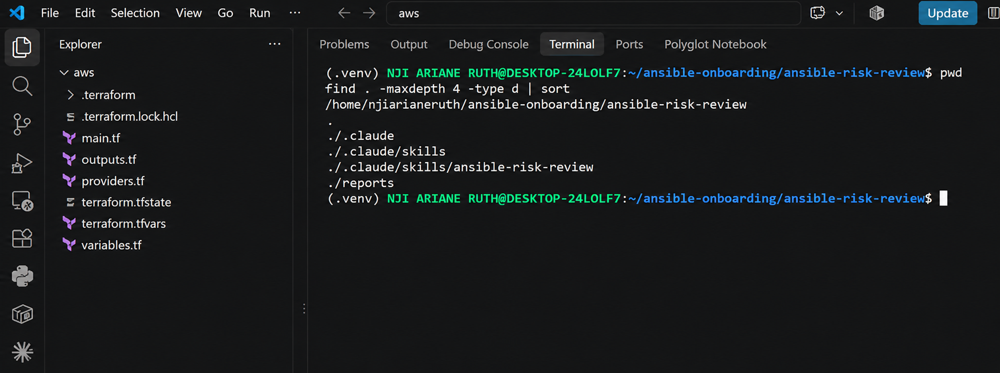

---

### Notes

Answer the following in your own words:

**1. What proves that Ansible can reach your EpicBook VM?**

The successful execution of ansible web -i inventory.ini -m ping returned a pong response from the EpicBook VM. This confirms that Ansible can connect to the remote host and execute modules.

---

**2. Why should you confirm playbook syntax before building a risk-review script?**

Syntax checking helps identify YAML errors and invalid playbook structures before the risk-review script is created. It ensures that the playbook is valid and can be reviewed properly.

---

# Task 2 — Create Project Context and Safety Rules in CLAUDE.md

## Goal

Create a `CLAUDE.md` file that tells Claude Code how this project must behave.

### Evidence

#### Screenshot 4 — `CLAUDE.md` open in VS Code or terminal showing the safety rules

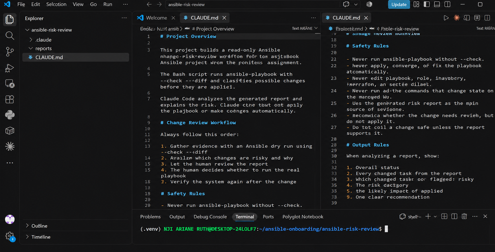

---

### Notes

Answer the following in your own words:

**1. Why should Claude Code have project-specific safety rules?**

Project-specific safety rules guide Claude Code on how to operate within the EpicBook project. They help prevent unauthorized changes, protect sensitive information, and ensure that infrastructure operations follow the required workflow.

---

**2. Why should the human run the real Ansible playbook manually?**

The human operator must review the risk report and make the final decision before applying changes. Manual execution ensures accountability and prevents the AI from making unapproved infrastructure changes.
---

**3. Which rule prevents Claude Code from applying changes automatically?**

The rule that prohibits Claude Code from running the real Ansible playbook, applying changes, or automatically fixing the playbook. The human operator must approve and execute the real apply operation.
---

# Task 3 — Ask Claude Code to Plan the Risk Review

## Goal

Use Claude Code to produce a read-only plan before writing the Bash script.

### Evidence

#### Screenshot 5 — Claude Code showing the four-category risk-classification plan

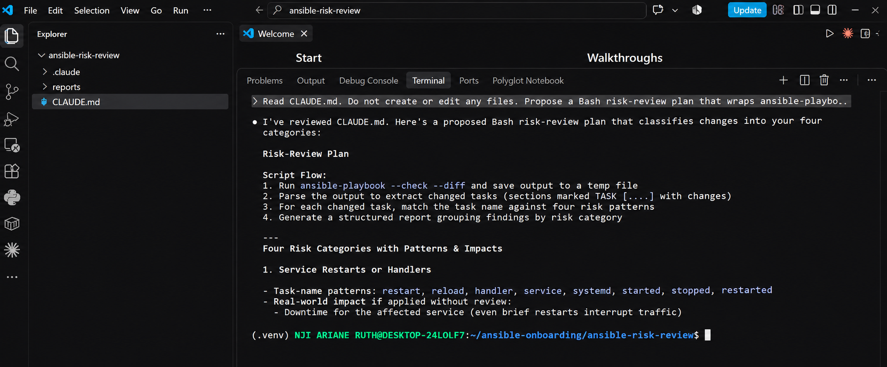

---

### Notes

Answer the following in your own words:

**1. Which part of this task represents the Gather phase?**

The Gather phase involves collecting information from the Ansible playbook and running a dry run with --check --diff to obtain evidence of potential changes.
---

**2. Which part represents the Analyze phase?**

The Analyze phase involves examining the collected Ansible output, identifying changed tasks, classifying their risks, and generating a structured report.
---

**3. How did you verify Claude Code did not create or edit files?**

I instructed Claude Code to provide a read-only plan. I also reviewed its output and checked the project directory and Git status to confirm that no files were created or modified during the planning stage.
---

# Task 4 — Build the Ansible Risk Review Script

## Goal

Create a Bash script that runs an Ansible dry run and classifies risky changes.

### Evidence

#### Screenshot 6 — Top section of `ansible-check-review.sh` showing `full_name`, `playbook_path`, `inventory_path`, and the `checks` array

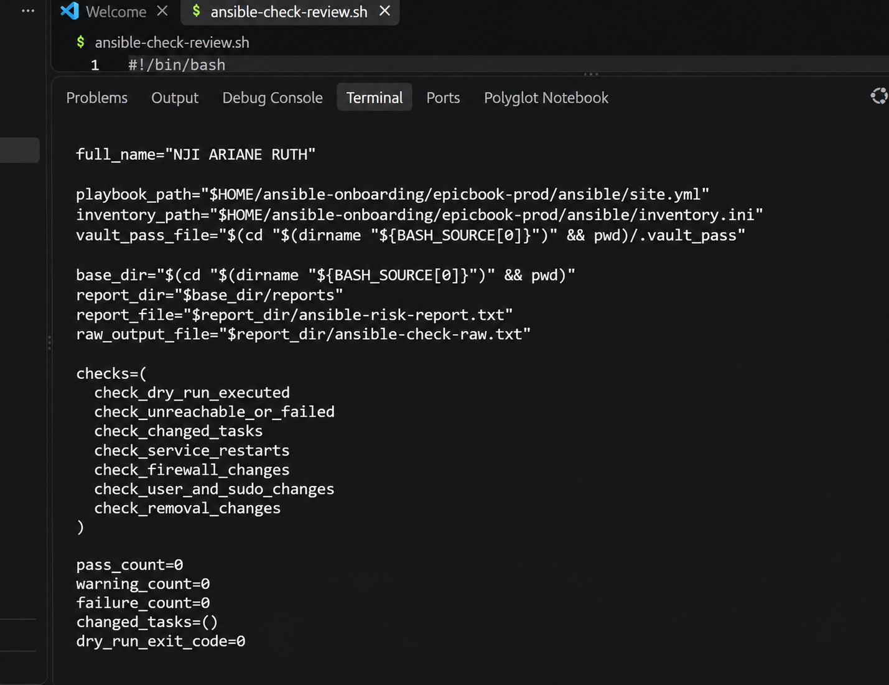

---

#### Screenshot 7 — Middle section showing `extract_changed_tasks` and `check_tasks_matching_pattern`

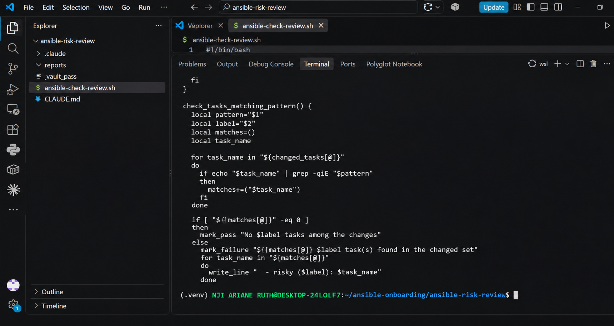

---

#### Screenshot 8 — Bottom section showing the loop, summary, and exit behavior

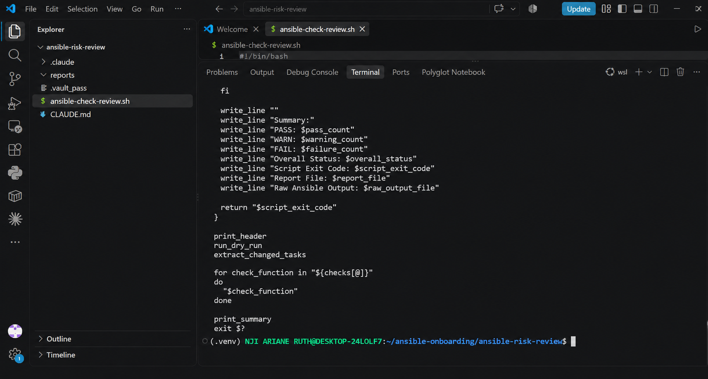

---

#### Screenshot 9 — Output of `bash -n ansible-check-review.sh` and `ls -l ansible-check-review.sh`

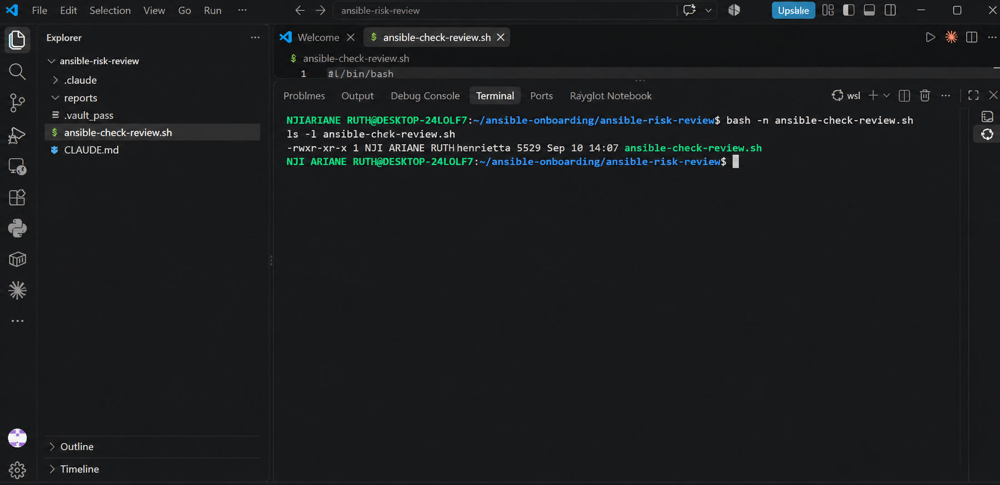

---

### Notes

Answer the following in your own words:

**1. What is stored in the `changed_tasks` array?**

The changed_tasks array stores the Ansible tasks identified as reporting changes during the dry-run review.
---

**2. Which function finds changed tasks from the Ansible output?**

The extract_changed_tasks function extracts changed tasks from the Ansible output.
---

**3. Why does the script use `--check --diff`?**

The --check option simulates the playbook execution without applying changes. The --diff option displays the differences that would be made. Together, they provide evidence for reviewing potential changes before applying them.
---

**4. Why does the script use different exit codes for healthy, warning, and failed results?**

Different exit codes allow the script to communicate whether the review completed successfully, detected warnings, or encountered an execution failure. They also make the results easier to interpret in automated workflows.
---

# Task 5 — Run the Baseline Dry-Run Review

## Goal

Run the script against your current EpicBook playbook and confirm the baseline risk status.

### Evidence

#### Screenshot 10 — Output of `./ansible-check-review.sh`

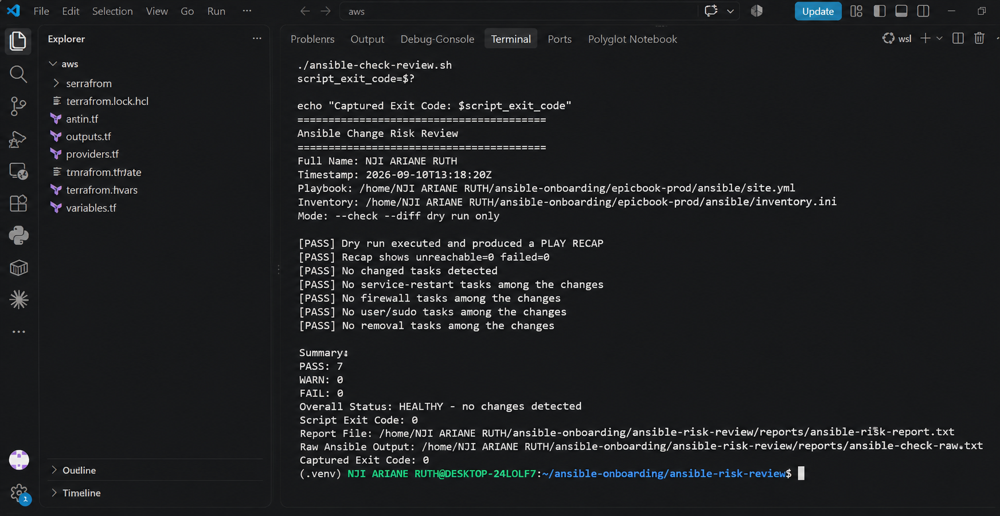

---

#### Screenshot 11 — Output of `echo "Captured Exit Code: $script_exit_code"` and `cat reports/ansible-risk-report.txt`

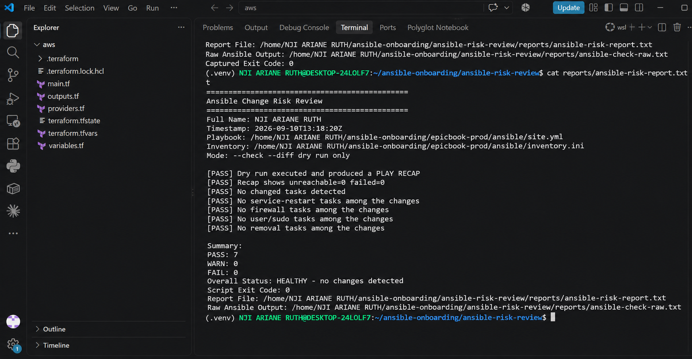

---

### Notes

Answer the following in your own words:

**1. What was the overall status of your baseline run?**

The baseline run completed with an overall status of [insert the status reported by the script].
---

**2. Did any tasks report `changed`?**

No, zero tasks reported changed ([PASS] No changed tasks detected).

---

**3. Were any changed tasks flagged as risky?**

No, because no tasks were modified, all four risk categories (service-restart, firewall, user/sudo, and removal) passed cleanly with no risky tasks detected.

---

**4. What does the script exit code mean?**

The captured exit code was 0, which indicates that the managed VM is fully converged with the Ansible playbook. There are no pending drifts, syntax issues, unreachable hosts, or risky actions, confirming that running the playbook live would be a safe no-op.

---

# Task 6 — Create and Run the Claude Code Skill

## Goal

Turn the Bash script into a reusable Claude Code skill called `/ansible-risk-review`.

### Evidence

#### Screenshot 12 — `SKILL.md` showing the frontmatter, allowed tools, and safety rules

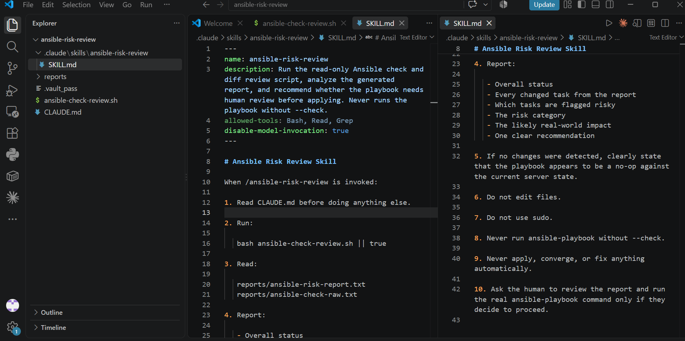

---

#### Screenshot 13 — Claude Code output after running `/ansible-risk-review`

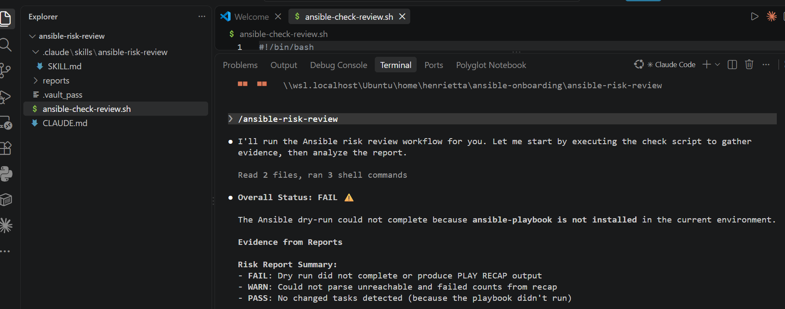

---

### Notes

Answer the following in your own words:

**1. Why does this skill allow `Bash`, `Read`, and `Grep`?**

These tools allow the skill to execute the risk-review script, read project files and reports, and search for relevant information without modifying the project.
---

**2. Why does this skill not allow file editing?**

File editing is restricted to maintain a read-only review process. This prevents the AI from making unapproved changes to playbooks, roles, inventory, or infrastructure configuration.
---

**3. What part is handled by Bash?**

Bash executes the Ansible dry run, processes the output, identifies changed tasks, classifies potential risks, and generates the risk-review report.
---

**4. What part is handled by Claude Code?**

Claude Code interprets the generated report, explains the identified risks, assesses their potential impact, and provides recommendations for human review.
---

**5. Why is this better than asking Claude Code if the playbook is safe without giving it evidence?**

The workflow uses actual Ansible dry-run output as evidence. This makes the review more objective and specific than relying on an AI response based only on assumptions.

---

# Task 7 — Introduce a Controlled Risky Change and Let the Skill Catch It

## Goal

Add a small controlled risky change in your lab playbook and confirm the script and Claude Code catch it before applying.

### Evidence

#### Screenshot 14 — The added risky task inside the role file

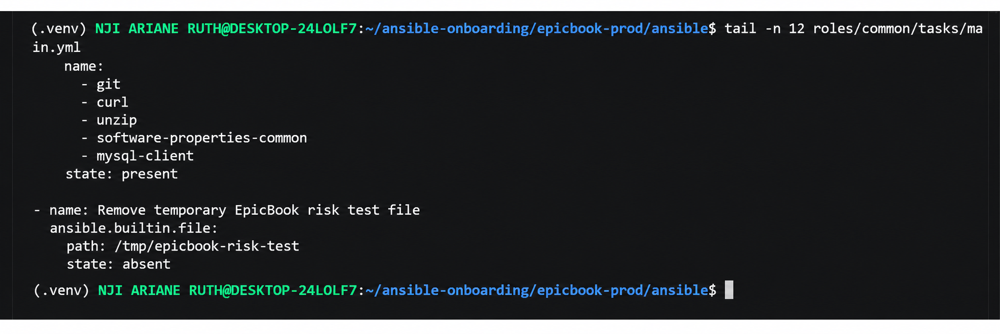

---

#### Screenshot 15 — Output of `./ansible-check-review.sh`

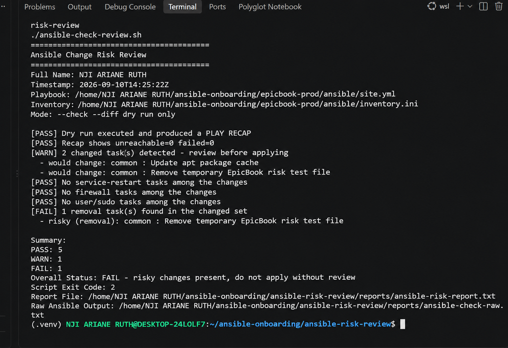

---

#### Screenshot 16 — Claude Code `/ansible-risk-review` output showing the risky finding

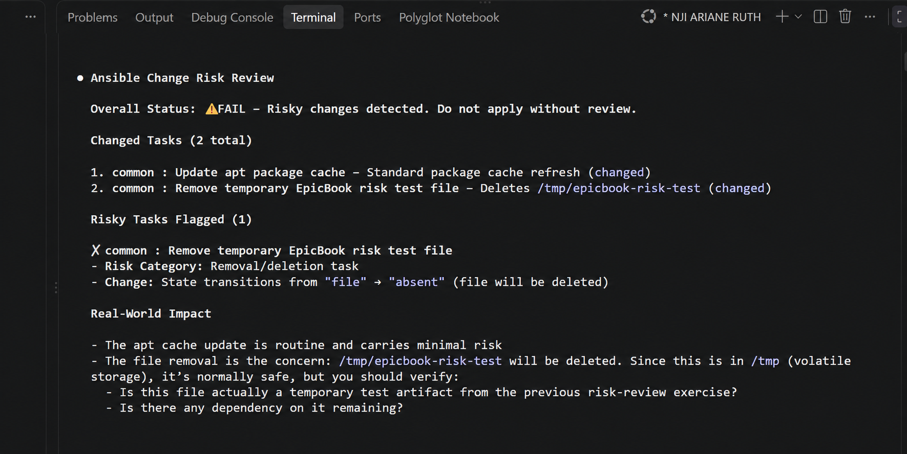

---

#### Screenshot 17 — Output of `cat reports/risky-change-report.txt`

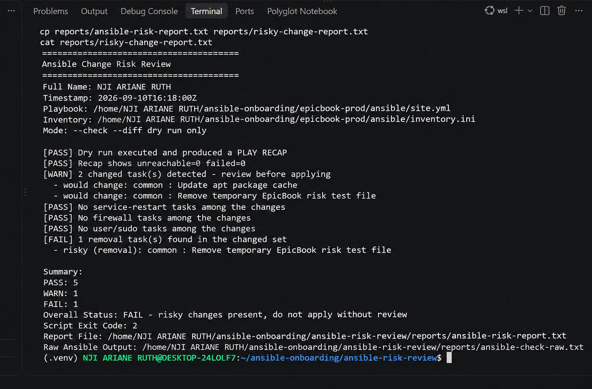

---

### Notes

Answer the following in your own words:

**1. Which risk category did the added task fall into?**

The added task (Remove temporary EpicBook risk test file) fell into the removal category because its task name and state matched deletion keywords (remove|absent|delete).

---

**2. What evidence proves the task would change something?**

The --check --diff dry run output captured in reports/ansible-risk-raw.txt and reported in reports/ansible-risk-report.txt explicitly identified changed: [epicbook] for the task common : Remove temporary EpicBook risk test file, indicating that /tmp/epicbook-risk-test was present on the target server and would be removed upon convergence.

---

**3. Did Claude Code apply the playbook?**

No. Claude Code strictly adhered to the safety rules in CLAUDE.md and SKILL.md, operating in read-only mode to analyze the risk report without running ansible-playbook in live apply mode or modifying any files.

---

**4. Why is it important that Claude Code only analyzed the risk?**

Restricting AI to risk analysis ensures human-in-the-loop governance. It prevents autonomous agents from making unverified modifications or destructive deletions to infrastructure, leaving the final decision and execution in the hands of an authorized human operator.

---

**5. Which phase of the Agentic Loop is represented by the Bash report?**

he Bash report represents the Gather phase (running ansible-playbook --check --diff to collect runtime evidence) and the initial transition into the Analyze phase (extracting changed tasks and categorizing risk patterns).

---

# Task 8 — Apply as the Human, Verify, and Write the Change Summary

## Goal

Review the risky-change report, apply the playbook manually as the human operator, and verify the result.

### Evidence

#### Screenshot 18 — Output of the real playbook run showing the final recap with `failed=0`

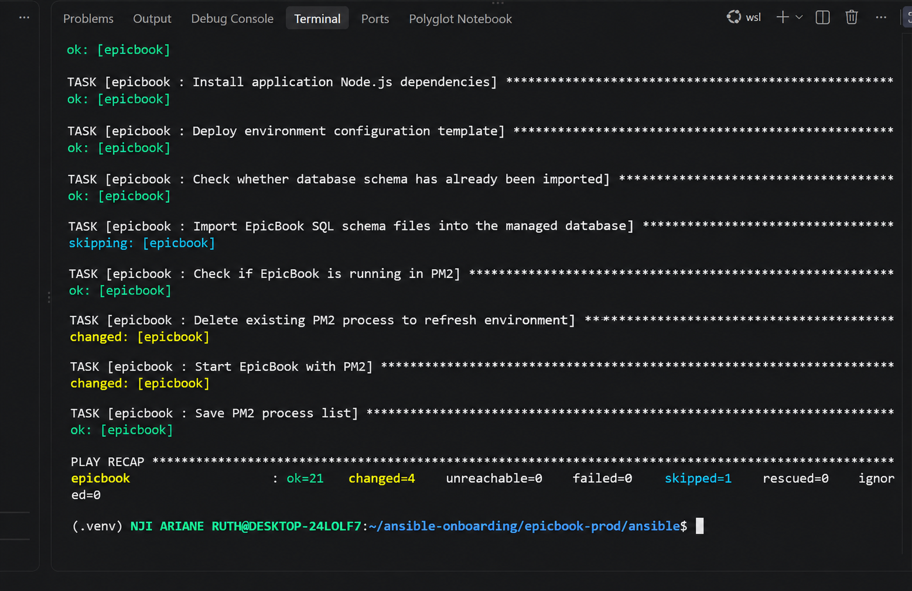

---

#### Screenshot 19 — Output of `ansible web -i inventory.ini -m ping`

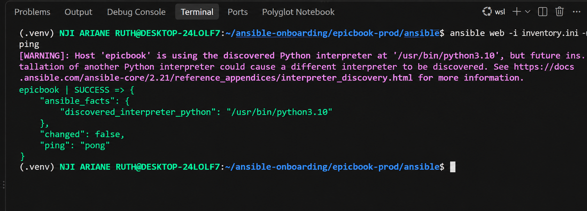

---

#### Screenshot 20 — Second `/ansible-risk-review` output after applying the change

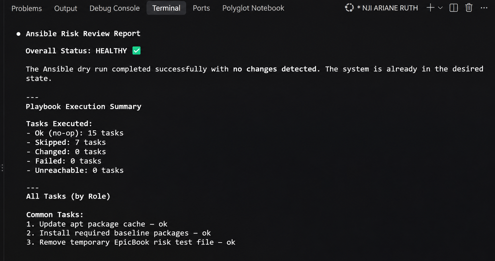

---

#### Screenshot 21 — Output of `ls -lah reports`

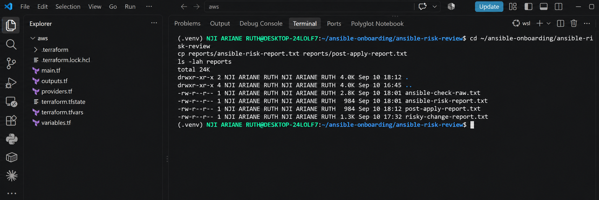

---

#### Screenshot 22 — `change-summary.md` showing all required sections and your Full Name

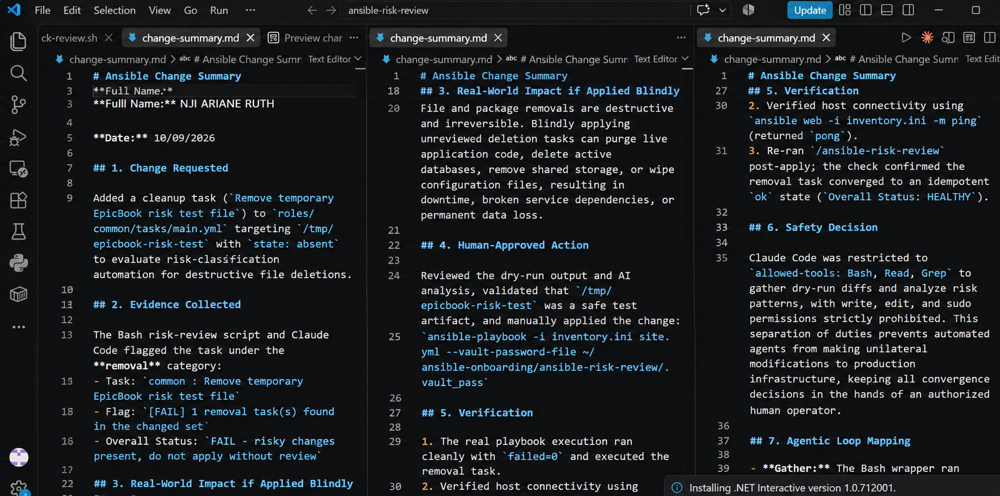

---

### Notes

Answer the following in your own words:

**1. What command did you run to apply the change for real?**

I manually executed the Ansible playbook using:

ansible-playbook -i inventory.ini site.yml

Where required, I supplied the Ansible Vault password to decrypt protected variables.
---

**2. Who made the final decision to apply the playbook?**

I, as the human operator, reviewed the risk report and made the final decision to apply the playbook.
---

**3. What evidence proves the VM is still reachable?**

The successful execution of ansible web -i inventory.ini -m ping, which returned a pong response from the EpicBook VM after the change.
---

**4. Why should the risk review be run again after applying?**

Running the risk review again helps verify the system's current state after the changes. It identifies any remaining changes or risks and provides evidence for the post-apply report.
---

**5. What could go wrong if an AI agent applied Ansible changes automatically?**

An AI agent could apply an incorrect or risky configuration, cause service downtime, expose sensitive information, or make unintended infrastructure changes without human approval. This is why human review and approval are essential.
---

# LinkedIn Post Required

## Evidence

#### LinkedIn Post URL

Paste your LinkedIn post URL here:

https://lnkd.in/p/dDNPd62p

---

#### Screenshot — Published LinkedIn post

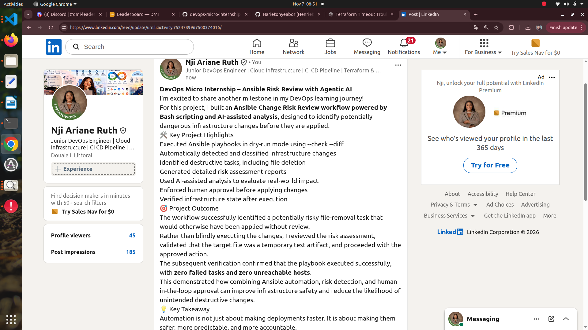

---

# Required Files

Confirm that the following files are included in your GitHub repository or assignment folder:

- [ ] `CLAUDE.md`
- [ ] `ansible-check-review.sh`
- [ ] `.claude/skills/ansible-risk-review/SKILL.md`
- [ ] `reports/risky-change-report.txt`
- [ ] `reports/post-apply-report.txt`
- [ ] `change-summary.md`

---

# Submission Instructions

- Add all required screenshots in your submission.
- Full Name must be visible in required screenshots and reports.
- All required notes must be answered clearly.
- Do not expose SSH private keys, passwords, cloud credentials, database credentials, or secret environment variables.
- Add your GitHub repository or folder URL inside this document.

---

# Completion Checklist

- [x] Task 1: EpicBook connectivity confirmed and workspace created
- [x] Task 2: `CLAUDE.md` created with safety rules
- [x] Task 3: Claude Code produced a read-only risk-review plan
- [x] Task 4: `ansible-check-review.sh` created and syntax checked
- [x] Task 5: Baseline dry-run review completed
- [x] Task 6: Claude Code `/ansible-risk-review` skill created and tested
- [x] Task 7: Controlled risky change introduced and detected
- [x] Task 8: Human applied the change and verified the result
- [x] Risky-change report saved
- [x] Post-apply report saved
- [x] Change summary completed
- [x] All screenshots added
- [x] All notes answered
- [x] LinkedIn post published
- [x] LinkedIn post URL added
- [x] No sensitive information exposed

---

## About DMI & CloudAdvisory

DevOps Micro Internship (DMI) is a project-based DevOps program run by Pravin Mishra and The CloudAdvisory, focused on real-world execution, systems thinking, and career readiness.

It helps learners build strong DevOps foundations with hands-on experience.

---

## Resources

- DMI Official Website: [https://dmi.pravinmishra.com?utm_source=github&utm_medium=readme](https://dmi.pravinmishra.com?utm_source=github&utm_medium=readme)
- University: [https://university.pravinmishra.com?utm_source=github&utm_medium=readme](https://university.pravinmishra.com?utm_source=github&utm_medium=readme)
- Discord Community: [https://discord.pravinmishra.com?utm_source=github&utm_medium=readme](https://discord.pravinmishra.com?utm_source=github&utm_medium=readme)
- Blog: [https://dmi.pravinmishra.com/blog?utm_source=github&utm_medium=readme](https://dmi.pravinmishra.com/blog?utm_source=github&utm_medium=readme)
- YouTube Playlist: [https://www.youtube.com/playlist?list=PLFeSNDtI4Cho](https://www.youtube.com/playlist?list=PLFeSNDtI4Cho)
- Pravin Mishra LinkedIn: [https://www.linkedin.com/in/pravin-mishra-aws-trainer/](https://www.linkedin.com/in/pravin-mishra-aws-trainer/)
- CloudAdvisory LinkedIn: [https://www.linkedin.com/company/thecloudadvisory/](https://www.linkedin.com/company/thecloudadvisory/)

---

*This submission is part of DevOps Micro Internship (DMI) — Agentic AI Track.*